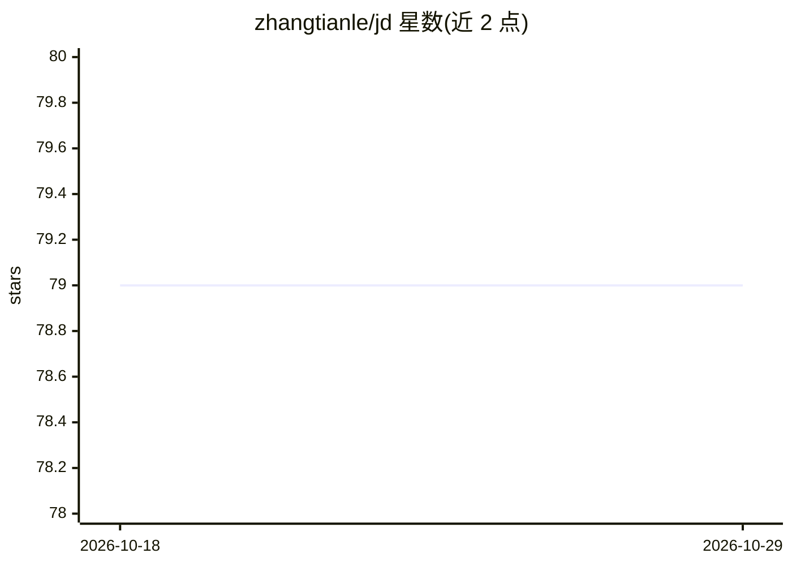

# zhangtianle/jd

⭐ 79 · Python · 推送 2026-08-11 · [GitHub](https://github.com/zhangtianle/jd) · [官网](http://jddjr.joybuy.com/) · 个人维护 · 中文 README

**京东金融2017信贷需求预测大赛的参赛方案总结文档**

记录作者参加2017京东金融全球数据探索者大赛（金融信贷需求预测赛题）的完整解题过程：赛题为基于8-11月用户借款、订单、点击及额度信息预测12月每用户贷款额，以RMSE评价。文档覆盖区间划分（避免数据穿越）、用户/点击/贷款/订单等多表特征提取、加密字段解密方法（log5(x+1)）、GBDT/XGB建模、TPOT自动调参与Stacking融合，最终A榜50、B榜48，并附数据网盘下载与第17名代码链接。属经验分享，非可安装产品。

## 筛选速览

| 维度 | 判定 | 备注 |
|---|---|---|
| AI 角色 | `ai-knowledge` | 知识聚合/清单类 |
| 许可风险 | `none` | — |
| 部署形态 | `None` |  |
| 模型依赖 | — | README 未给出锁定关系 |
| 硬件要求 | — | 无带数字的原话,不猜 |
| 安装摩擦 | `low` | 无编译、无系统依赖或容器化 |
| 成熟度 | — | 结构信号不足 |

## 能力要点

- 详细列出用户/点击/贷款/订单四类表的60余维特征及其含义
- 给出避免数据穿越的两种区间划分方案及实测对比
- 记录GBDT/XGB参数与Stacking、加权平均等融合尝试
- 提供赛题数据百度网盘下载与第17名代码仓库链接

## 适用场景

- 学习信贷需求预测类回归赛题的完整解题流程
- 参考时间序列区间划分与防数据穿越的实践
- 了解表格特征工程（聚合统计、one-hot、交叉特征）的做法

## 场景标签

`金融量化` · 领域:学习与行业

## 证据(README 行号)

> L20: 京东金融提供8到11月的用户借款信息，订单购买信息，页面点击信息以及用户个人和贷款的初始额度信息；要求预测12月每个用户的贷款信息。评价方式采用RMSE函数：
> L133: 一看题目，咋们就很明显的看出这是一个回归问题，那么我们就先选用回归的各种模型来尝试，比如 GBDT、XGB、LR、 Ridge。

## 星数曲线

2026-10-18 79 → 2026-10-29 79（+0）

---
*卡片 v1 · prompt 1.4 · 生成 2026-10-24 · 置信度 high · 依据 README sha `f40941c0f558` · [字段定义](../../DATASET.md)*
