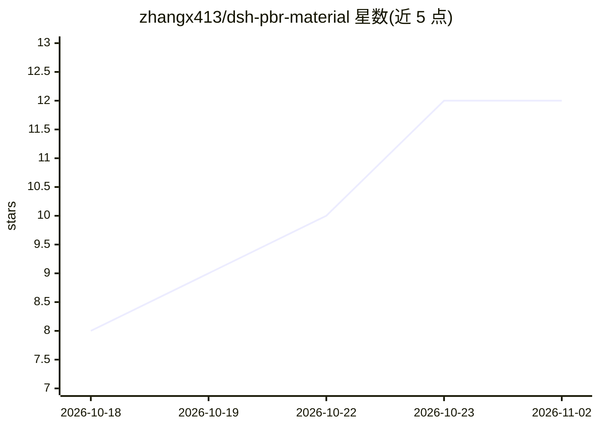

# zhangx413/dsh-pbr-material

⭐ 12 · JavaScript · MIT · 推送 2026-10-27 · [GitHub](https://github.com/zhangx413/dsh-pbr-material) · 个人维护 · 中文 README

**DSH 插件：照片本地生成可平铺 PBR 材质贴图全套**

DeepSeek Harness 的插件，把一张表面照片转换为一套可平铺 PBR 贴图（albedo/normal/height/roughness/AO/curvature/metallic，数据贴图 16-bit），全程本地通过 ComfyUI 运行：generate 模式先用 FLUX.2 Klein 4B 指令编辑将照片重绘为平面 albedo，再做确定性 PBR 推导；direct 模式跳过重绘保留照片原生细节。提供整页工作台面板、五个 agent 工具、REST API；agent 可自检环境并自动下载 12.5 GB 权重（含 hf-mirror 回退与断点续传），不触碰用户 API key。面向使用 DeepSeek Harness 的 3D/游戏资产制作者。

## 筛选速览

| 维度 | 判定 | 备注 |
|---|---|---|
| AI 角色 | `ai-native` | 本体是模型或模型工具 |
| 许可风险 | `permissive` | MIT |
| 部署形态 | `library` | 以包/库形式分发 |
| 模型依赖 | — | README 未给出锁定关系 |
| 硬件要求 | — | 无带数字的原话,不猜 |
| 安装摩擦 | `low` | 无编译、无系统依赖或容器化 |
| 成熟度 | — | 结构信号不足 |

## 能力要点

- photo→PBR 全流程：FLUX.2 Klein 4B 重绘 + 确定性推导，数据贴图 16-bit
- direct/generate 双模式，direct 保留原生分辨率与真实细节
- 五个 agent 工具：环境自检、后台部署（权重下载可续传、镜像回退）、生成、量测
- 独立 run root 与端口，不写入用户 ComfyUI，零运行时依赖

## 适用场景

- 游戏/3D 资产制作中把实拍照片转成 PBR 材质
- 对已有贴图集做平铺量测与 3×3 预览
- 在 DeepSeek Harness 对话里让 agent 自动部署环境并生成材质

## 场景标签

`图像生成` `图像视频处理` · 领域:内容生成

## 证据(README 行号)

> L3: 把一张物体的照片变成一整套**可平铺的 PBR 贴图**（albedo / normal / height / roughness /
> L41: |是什么|**照片就是 albedo**，只做平铺 + 推导|先用 FLUX.2 Klein 把照片重绘成平面 albedo，再推导|
> L63: |`pbr_material_from_photo`|全流程一条龙，`mode="direct"`/`"generate"`，返回贴图路径 + 平铺量测|

## 星数曲线

2026-10-18 8 → 2026-11-02 12（+4）

---
*卡片 v1 · prompt 1.4 · 生成 2026-10-31 · 置信度 mid · 依据 README sha `4123bef8ea9e` · [字段定义](../../DATASET.md)*
