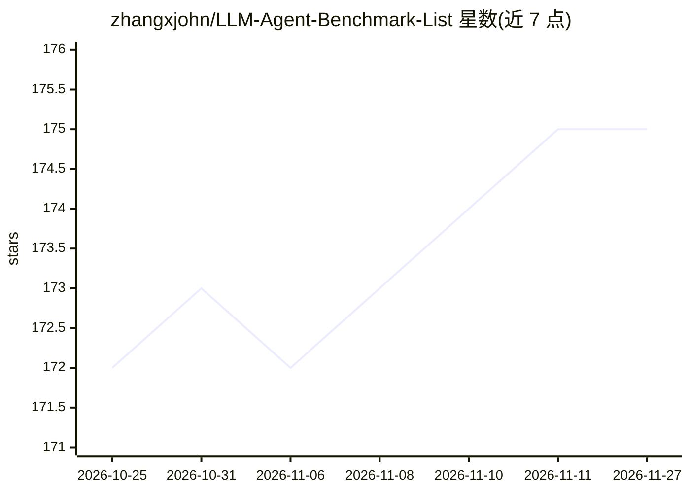

# zhangxjohn/LLM-Agent-Benchmark-List

⭐ 175 · Apache-2.0 · 推送 2026-11-25 · [GitHub](https://github.com/zhangxjohn/LLM-Agent-Benchmark-List) · 个人维护 · 中文 README

**面向 LLM/Agent 评测研究者的基准论文分类清单**

以论文清单形式组织的大模型与 Agent 评测资源汇编，按 Survey、ToolUse、Reasoning、Knowledge、Graph、Video、Code、Alignment、Agent、Multimodal 等类别收录基准与综述条目，每条附作者、机构、发表渠道与论文/项目页链接。欢迎通过 PR、issue 或邮件贡献补充，README 标注持续更新。仅提供条目索引，不包含可运行的评测代码或安装说明。

## 筛选速览

| 维度 | 判定 | 备注 |
|---|---|---|
| AI 角色 | `ai-knowledge` | 知识聚合/清单类 |
| 许可风险 | `permissive` | Apache-2.0 |
| 部署形态 | `None` |  |
| 模型依赖 | — | README 未给出锁定关系 |
| 硬件要求 | — | 无带数字的原话,不猜 |
| 安装摩擦 | `low` | 无编译、无系统依赖或容器化 |
| 成熟度 | — | 结构信号不足 |

## 能力要点

- 按工具使用、推理、知识、图、视频、代码、对齐、Agent 等类别组织的基准条目
- 每条条目附作者、机构、arXiv/会议出处及论文与项目页链接
- 接受 PR、issue、邮件等多种贡献方式，标注持续更新

## 适用场景

- 为 LLM 评测寻找合适的基准数据集与论文
- 调研 Agent 评测领域的已有工作
- 在论文写作时检索相关评测方法条目

## 场景标签

`精选清单` · 领域:学习与行业

## 证据(README 行号)

> L9: In the swiftly evolving landscape of artificial intelligence, Large Language Models (LLMs) have emerged as a pivotal
> L11: ## :dizzy: List
> L13: #### Survey

## 星数曲线

2026-10-25 172 → 2026-11-27 175（+3）

---
*卡片 v1 · prompt 1.4 · 生成 2026-11-26 · 置信度 high · 依据 README sha `83fc20ac748d` · [字段定义](../../DATASET.md)*
