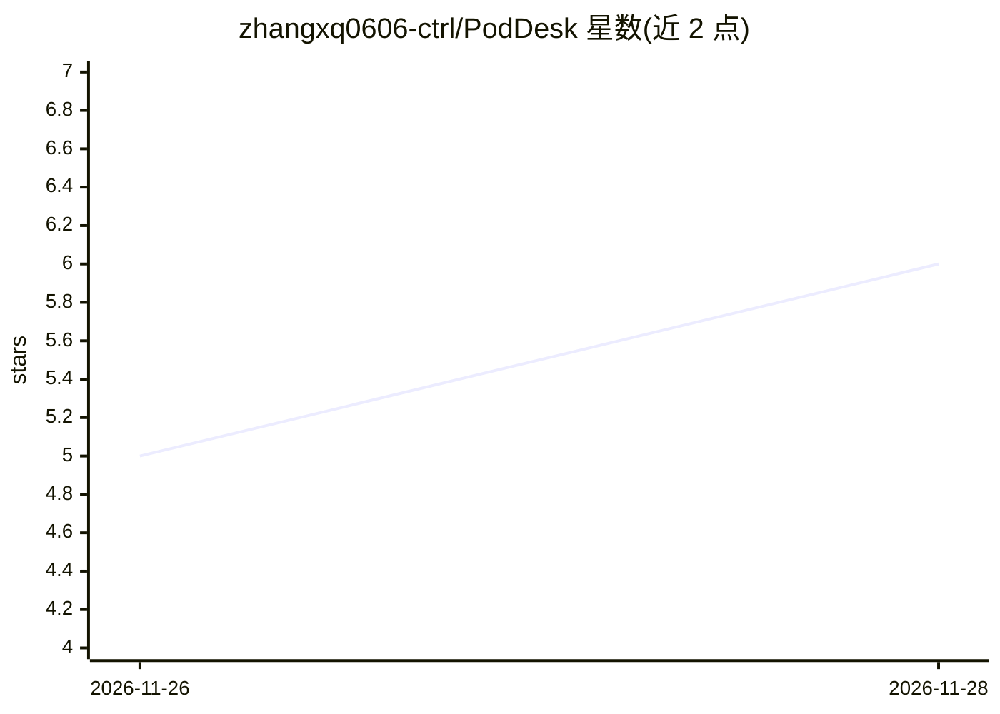

# zhangxq0606-ctrl/PodDesk

⭐ 6 · TypeScript · AGPL-3.0 · 推送 2026-11-27 · [GitHub](https://github.com/zhangxq0606-ctrl/PodDesk) · [官网](https://poddesk.captainxq.me) · 个人维护 · 中文 README

**本地优先的双语播客与视频 AI 问答工作台**

面向中英文播客与 YouTube 视频的桌面端工作台（Tauri v2），功能覆盖多源取稿（YouTube/Apple Podcasts/小宇宙/RSS/本地音视频）、三层字幕（官方字幕、本机离线 ASR、云端转写）、术语感知双语精译、章节导读与播放位置感知的 AI 问答。自动探测复用本机已登录的 6 款 CLI Agent，亦支持接入多家模型 API。数据存本地 SQLite，API Key 存系统钥匙串，无账号体系。Windows/macOS 提供安装包，Intel macOS 可从源码构建。

## 筛选速览

| 维度 | 判定 | 备注 |
|---|---|---|
| AI 角色 | `ai-native` | 本体是模型或模型工具 |
| 许可风险 | `viral` | AGPL-3.0 |
| 部署形态 | `desktop` | 安装包/桌面程序 |
| 模型依赖 | local-ok | 支持本地模型 |
| 硬件要求 | — | 无带数字的原话,不猜 |
| 安装摩擦 | `medium` | 含编译或系统依赖之一 |
| 成熟度 | `idea` | |

## 能力要点

- 本机离线转写（SenseVoice-Small / Qwen3-ASR，适配 Vulkan/CUDA/Metal/CPU）
- 自动探测并复用本机已登录的 6 款 CLI Agent，导读与问答实时感知播放进度
- 支持 YouTube、Apple Podcasts、小宇宙、RSS 与本地文件多源取稿
- 术语感知双语精译，标题三档切换

## 适用场景

- 收听中英文播客时获得双语字幕与术语级翻译
- 对播客/视频内容边听边向 AI 提问并回跳原声
- 在本地离线环境下转写音频而音频不出本机

## 场景标签

`语音识别` `文档问答` · 领域:知识与检索

## 证据(README 行号)

> L7: 面向中英文播客与 YouTube 视频的本地优先 AI 工作台：多源取稿、本机离线转写、双语精译与在场感问答。
> L26: - **三层字幕，音频不出本机**：优先拉取官方字幕；无字幕时可调用本机离线模型（`SenseVoice-Small` / `Qwen3-ASR 0.6B` / `1.7B`，基于 `CrispASR` + `Silero VAD
> L28: - **把常用 AI Agent 请到收听现场**：自动探测并复用本机已登录的 6 款 CLI Agent（Claude Code、Codex、Antigravity CLI、Qwen Code、Kimi Code、OpenCod

## 星数曲线

2026-11-26 5 → 2026-11-28 6（+1）

---
*卡片 v1 · prompt 1.4 · 生成 2026-11-26 · 置信度 high · 依据 README sha `f7f5fc0f307e` · [字段定义](../../DATASET.md)*
