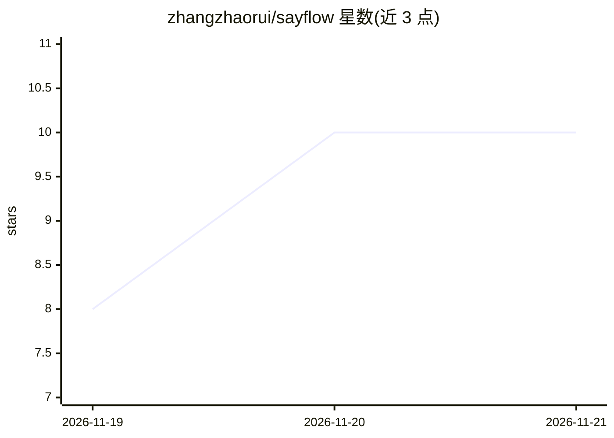

# zhangzhaorui/sayflow

⭐ 10 · Swift · GPL-3.0 · 推送 2026-11-18 · [GitHub](https://github.com/zhangzhaorui/sayflow) · [官网](https://github.com/zhangzhaorui/sayflow) · 个人维护 · 中文 README

**macOS 输入法：离线 Rime 打字+可选语音与AI改写**

基于 Rime 的 macOS 开源输入法，打字覆盖全拼整句、多种双拼、五笔 86 及五笔+拼音混输，完全本机运行不上传按键。联网功能三项默认可关：按住右 Command 的语音输入、AI 整理语音结果（去口头禅、补标点）、⌃⌥R 对选中文字 AI 改写；语音与 AI 通过任何兼容 OpenAI API 格式的网关接入，需自填地址、模型与 API Key。需 Apple 芯片 Mac，经脚本编译 librime 后打包 DMG，安装到 /Library/Input Methods，GPL-3.0 许可。

## 筛选速览

| 维度 | 判定 | 备注 |
|---|---|---|
| AI 角色 | `ai-enhanced` | 去掉 AI 部分产品仍成立 |
| 许可风险 | `viral` | GPL-3.0 |
| 部署形态 | `desktop` | 安装包/桌面程序 |
| 模型依赖 | local-ok | 支持本地模型 |
| 硬件要求 | — | 无带数字的原话,不猜 |
| 安装摩擦 | `low` | 无编译、无系统依赖或容器化 |
| 成熟度 | — | 结构信号不足 |

## 能力要点

- Rime 打字引擎完全离线，不记录不上传按键
- 语音输入、AI 整理、AI 改写三项联网功能各自独立开关，默认关闭
- 语音与 AI 走兼容 OpenAI API 的自定义网关（可接 one-api/new-api/OpenAI/Groq/本地 Ollama）
- 搭配 remote-mic-app 可用小米蓝牙遥控器当无线麦克风

## 适用场景

- 想要不联网不上传按键的 mac 中文输入法
- 按住按键说话直接出字的语音输入
- 对选中文本一键改写润色
- 用自有 API 网关接入语音识别与改写模型

## 场景标签

`语音识别` `AI 写作` · 领域:内容生成

## 证据(README 行号)

> L3: macOS 上的开源输入法：Rime 打字（全拼整句、小鹤 / 自然码 / 微软双拼、五笔 86、五笔 + 拼音混输）+ 语音输入 + AI 整理 + 选中文字 AI 改写。
> L38: 语音识别和 AI 功能需要一个兼容 OpenAI API 格式的后端。在「语音与 AI」设置里填写：

## 星数曲线

2026-11-19 8 → 2026-11-21 10（+2）

---
*卡片 v1 · prompt 1.4 · 生成 2026-11-20 · 置信度 high · 依据 README sha `14209997973e` · [字段定义](../../DATASET.md)*
