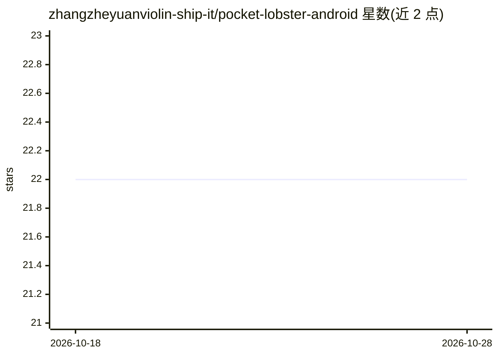

# zhangzheyuanviolin-ship-it/pocket-lobster-android

⭐ 22 · Kotlin · GPL-3.0 · 推送 2026-10-12 · [GitHub](https://github.com/zhangzheyuanviolin-ship-it/pocket-lobster-android) · 个人维护 · 中文 README

**非 root Android 手机上的多智能体工作平台（四智能体协作）**

运行在非 root ARM64 Android 8.0+ 手机上的原生应用，把 Codex、Claude Code、OpenMinis 和手机操作智能体放进同一应用。前三个可独立工作或进入三智能体协作模式（星形消息链路，总调度审核成员结果）；手机操作智能体读取屏幕并输出 Tap/Type/Swipe 等动作操作 Android 应用。共享 Android 本地终端、Ubuntu 24.04（PRoot）、Alpine 三套终端与真实浏览器，通过 Shizuku 获得系统 shell。以 APK 分发（prod/test/beta 三渠道），GPL v3。

## 筛选速览

| 维度 | 判定 | 备注 |
|---|---|---|
| AI 角色 | `ai-native` | 本体是模型或模型工具 |
| 许可风险 | `viral` | GPL-3.0 |
| 部署形态 | `None` |  |
| 模型依赖 | locked-api |  |
| 硬件要求 | — | 无带数字的原话,不猜 |
| 安装摩擦 | `high` | 编译与系统依赖俱全 |
| 成熟度 | — | 结构信号不足 |

## 能力要点

- Codex、Claude Code、OpenMinis 三智能体协作（总调度委派与结果审核）
- 手机操作智能体：读取屏幕输出 Launch/Tap/Type 等动作，支持主屏幕或隔离虚拟屏幕
- 三套共享终端（Termux 风格/Ubuntu PRoot/Alpine）加 Shizuku system-shell 与共享浏览器
- 从屏幕阅读器使用出发的无障碍设计与明确权限确认机制

## 适用场景

- 在手机上运行 Codex/Claude Code 完成代码与终端工程任务
- 让多个智能体协作处理需要委派子任务的复杂工作
- 用手机操作智能体在真机或虚拟屏幕上自动操作 Android 应用

## 场景标签

`多智能体` `编码 Agent` `GUI 自动化` · 领域:Agent 开发

## 证据(README 行号)

> L3: 口袋大龙虾是一套运行在非 root ARM64 Android 手机上的多智能体工作平台。它把 Codex、Claude Code、OpenMinis 和手机操作智能体放进同一个原生应用，让模型不仅能对话，还能使用三套终端、真实可见
> L22: 应用提供四个独立入口。Codex、Claude Code 和 Minis 既能独立工作，也能进入三智能体协作模式；手机操作智能体是独立的第四个入口，负责在主屏幕或隔离虚拟屏幕中操作 Android 应用。v341 将手机操作智能体
> L42: 手机操作智能体读取实时屏幕画面并输出 Launch、Tap、Type、Swipe、Back、Home、Wait、Double Tap、Long Press、Take over 或 Finish 动作。用户可以选择主屏幕或隔离虚拟屏

## 星数曲线

2026-10-18 22 → 2026-10-28 22（+0）

---
*卡片 v1 · prompt 1.4 · 生成 2026-10-27 · 置信度 high · 依据 README sha `5e2988779f26` · [字段定义](../../DATASET.md)*
