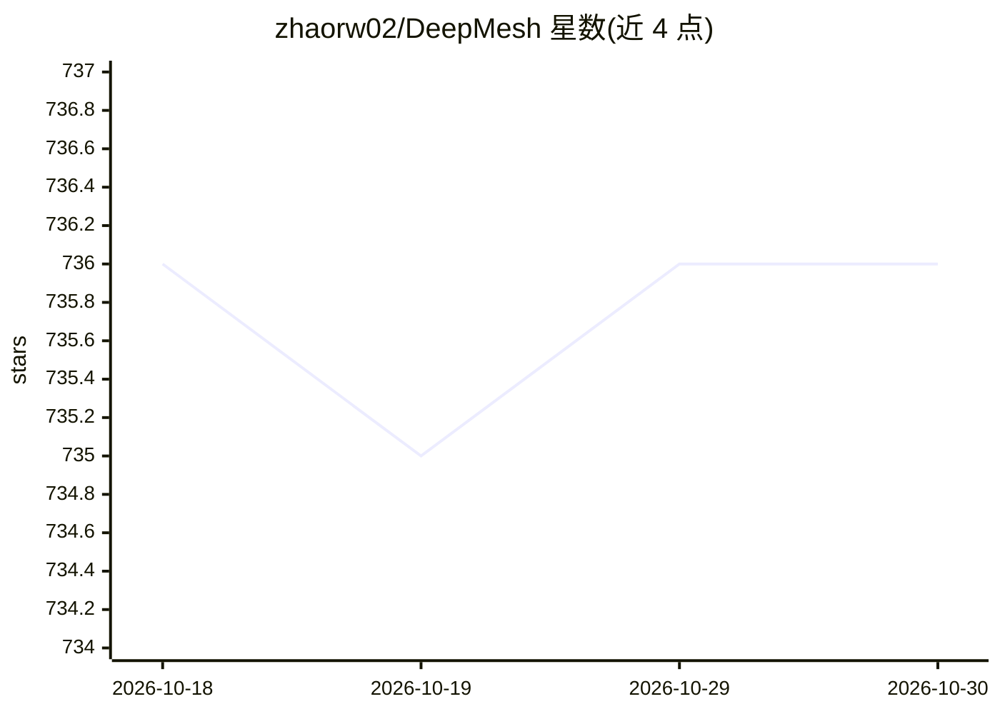

# zhaorw02/DeepMesh

⭐ 736 · Python · Apache-2.0 · 推送 2025-12-17 · [GitHub](https://github.com/zhaorw02/DeepMesh) · [官网](https://zhaorw02.github.io/DeepMesh/) · 组织维护

**点云条件下的自回归网格生成模型（ICCV 2025）**

ICCV 2025 论文 DeepMesh 的官方代码：基于自回归 transformer 与强化学习（DPO 后训练），从给定点云生成艺术家级网格（artist-mesh）。已发布 0.5B 预训练权重，推理代码经优化使生成时间减半。环境在 Ubuntu 22、CUDA 11.8 与 A100/A800/A6000 上测试；通过 conda 环境安装，模型权重经 HuggingFace Hub 下载。预训练与后训练（DPO）代码及 1B 版本尚未发布，属训练/推理部分放出的研究代码。

## 筛选速览

| 维度 | 判定 | 备注 |
|---|---|---|
| AI 角色 | `ai-native` | 本体是模型或模型工具 |
| 许可风险 | `permissive` | Apache-2.0 |
| 部署形态 | `library` | 以包/库形式分发 |
| 模型依赖 | — | README 未给出锁定关系 |
| 硬件要求 | — | 无带数字的原话,不猜 |
| 安装摩擦 | `medium` | 含编译或系统依赖之一 |
| 成熟度 | — | 结构信号不足 |

## 能力要点

- 点云条件下自回归生成 artist-mesh
- 基于强化学习（DPO）的后训练方法
- 已发布 0.5B 预训练权重，支持命令行推理
- 推理代码优化，生成时间减少 50%

## 适用场景

- 我有点云数据，想生成对应的三角网格
- 复现论文中的网格生成实验
- 3D 内容生成研究中的基线对比

## 场景标签

`强化学习` · 领域:训练与推理

## 证据(README 行号)

> L28: **All of the meshes above are generated by DeepMesh.** DeepMesh can generate high-quality meshes conditioned on the
> L31: - [3/20] 🔥🔥We released the pretrained weight of **DeepMesh** (0.5 B).

## 星数曲线

2026-10-18 736 → 2026-10-30 736（+0）

---
*卡片 v1 · prompt 1.4 · 生成 2026-10-22 · 置信度 mid · 依据 README sha `3a8e741ba106` · [字段定义](../../DATASET.md)*
