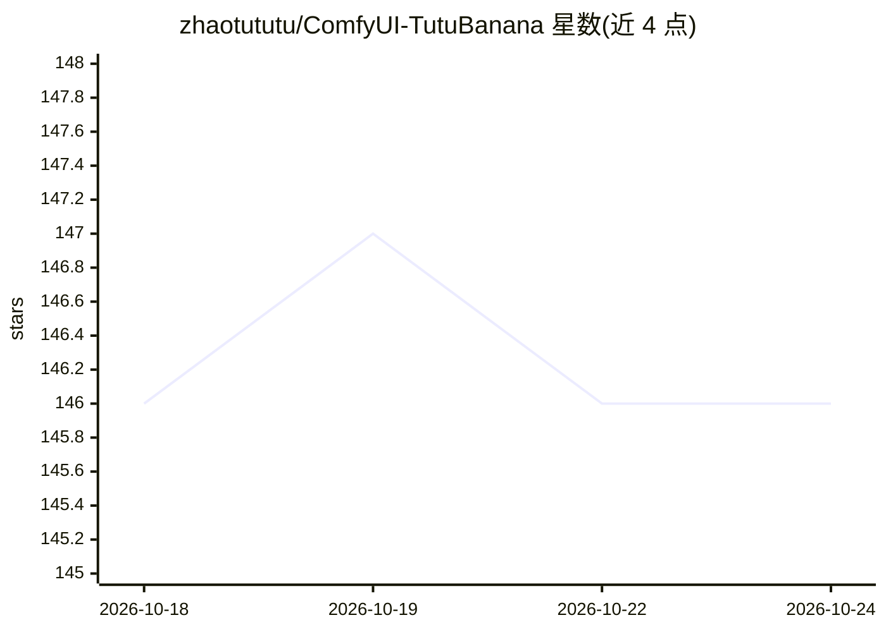

# zhaotututu/ComfyUI-TutuBanana

⭐ 146 · Python · Apache-2.0 · 推送 2025-11-26 · [GitHub](https://github.com/zhaotututu/ComfyUI-TutuBanana) · 个人维护 · 中文 README

**ComfyUI 的 Gemini 图像生成节点套件，接多平台 API**

面向 ComfyUI 用户的自定义节点套装，调用 Google Gemini 系列模型（Nano Banana）的 API 生成与编辑图像。提供三个节点：提示词模板管理器（内置 333 个中英双语模板、10 大类别）、双平台节点（OpenRouter / ai.comfly.chat，最多 5 路图像输入）、专业版节点（Google 官方 API / T8Star，最多 14 路输入，支持宽高比与 1K-4K 分辨率控制，Google 官方可启用搜索增强）。支持端口到图片编号的自动索引映射与种子随机控制。需自备 API 密钥，通过 Git 克隆或手动下载安装。

## 筛选速览

| 维度 | 判定 | 备注 |
|---|---|---|
| AI 角色 | `ai-native` | 本体是模型或模型工具 |
| 许可风险 | `permissive` | Apache-2.0 |
| 部署形态 | `library` | 以包/库形式分发 |
| 模型依赖 | locked-api |  |
| 硬件要求 | — | 无带数字的原话,不猜 |
| 安装摩擦 | `low` | 无编译、无系统依赖或容器化 |
| 成熟度 | — | 结构信号不足 |

## 能力要点

- 四个 API 平台支持：OpenRouter、ai.comfly.chat、Google 官方、T8Star
- 内置 333 个中英双语提示词模板，10 大类别
- 专业版最多 14 路图像输入，支持宽高比与 1K/2K/4K 分辨率控制
- 端口到图片编号的自动索引映射与随机种子控制

## 适用场景

- 在 ComfyUI 工作流中调用 Gemini 模型做文生图或图生图
- 用模板管理器快速套用专业提示词
- 多图合成编辑，如把图1人物放到图2背景并套用图3风格
- Google 官方 API 下生成 4K 高分辨率图像

## 场景标签

 · 领域:AI 图像生成/ComfyUI 生态

## 证据(README 行号)

> L18: ComfyUI-TutuBanana 是一个功能强大的ComfyUI自定义节点套装，专为Google Gemini系列模型的图像生成而设计。该项目提供了三个核心节点，涵盖从提示词模板管理到多平台API调用的完整工作流程。
> L22: - 🎨 **三大核心节点**：提示词模板管理器 + 双API平台支持 + Google官方API专业版
> L98: - 🏢 **Google官方API直连**：使用官方Gemini 3 Pro API

## 星数曲线

2026-10-18 146 → 2026-10-24 146（+0）

---
*卡片 v1 · prompt 1.4 · 生成 2026-10-22 · 置信度 mid · 依据 README sha `0824c2c6718f` · [字段定义](../../DATASET.md)*
