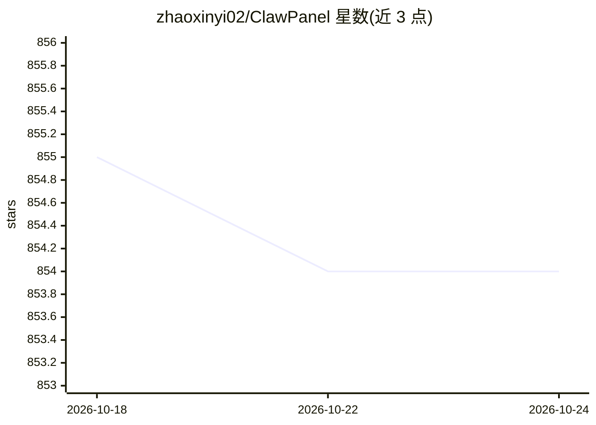

# zhaoxinyi02/ClawPanel

⭐ 855 · Go · NOASSERTION · 推送 2026-06-08 · [GitHub](https://github.com/zhaoxinyi02/ClawPanel) · [官网](https://clawpanel.cc) · 个人维护 · 中文 README

**OpenClaw AI 助手的可视化管理面板：单二进制管理多通道运行时**

Go 单二进制 + React 18 的 Web 管理面板，用于安装、接管与观测 OpenClaw AI 助手引擎及其网关、NapCat 等外部运行时。功能覆盖 20+ 消息通道（QQ/微信/飞书/Telegram 等）统一管理、模型提供商配置（OpenAI/Anthropic/Gemini/DeepSeek/Ollama 等）、多 Agent 工作台与路由、Workflow Center、插件/技能市场、SQLite 日志与 WebSocket 实时推送。跨平台一键脚本安装，更新走 GitHub Releases。声明仅供学习研究、禁止商用，第三方客户端登录 QQ/微信存在封号风险；Lite 发行线已停止维护。

## 筛选速览

| 维度 | 判定 | 备注 |
|---|---|---|
| AI 角色 | `ai-ecosystem` | LLM/agent 周边工具 |
| 许可风险 | `none` | NOASSERTION |
| 部署形态 | `desktop` | 安装包/桌面程序 |
| 模型依赖 | — | README 未给出锁定关系 |
| 硬件要求 | — | 无带数字的原话,不猜 |
| 安装摩擦 | `medium` | 含编译或系统依赖之一 |
| 成熟度 | — | 结构信号不足 |

## 能力要点

- Go 单二进制部署，Linux/macOS/Windows 一键脚本安装并注册系统服务
- 统一管理 20+ 通道与 OpenClaw/NapCat 等外部运行时
- 多 Agent 工作台、Binding 路由规则与 Workflow Center 可视化编排
- 面板内更新基于 GitHub Releases，含 SHA256 校验与二进制回滚

## 适用场景

- 在服务器或 NAS 上部署并管理 OpenClaw AI 助手
- 统一配置 QQ/微信等多平台消息通道
- 管理多个 Agent 的模型提供商与路由规则

## 场景标签

 · 领域:AI 助手运维/管理面板

## 证据(README 行号)

> L3: **OpenClaw 智能管理面板 — 单一标准版发行，专注轻量面板接管与外部运行时管理**
> L34: - OpenClaw、NapCat、插件和通道运行时均作为外部资源管理：可由面板引导安装，也可接管已有网关。
> L39: - 仪表盘展示 OpenClaw、网关、通道、模型、消息、任务和系统资源状态。

## 星数曲线

2026-10-18 855 → 2026-10-24 854（-1）

---
*卡片 v1 · prompt 1.4 · 生成 2026-10-21 · 置信度 mid · 依据 README sha `019667a40d56` · [字段定义](../../DATASET.md)*
