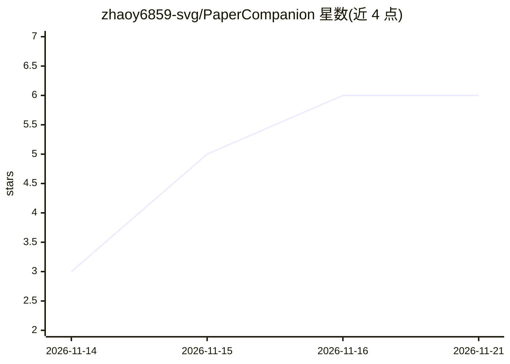

# zhaoy6859-svg/PaperCompanion

⭐ 6 · Swift · MIT · 推送 2026-11-20 · [GitHub](https://github.com/zhaoy6859-svg/PaperCompanion) · [官网](https://github.com/zhaoy6859-svg/PaperCompanion/releases/latest) · 个人维护 · 中文 README

**给论文精读者的 macOS/Windows 桌面 App：PDF 阅读+AI 问答+LaTeX 译文**

面向论文读者的桌面应用：左侧读 PDF，右侧 AI 伴侣按熟悉程度调整解释深度，问答支持 Markdown、公式、表格，保存全部对话记录并用分批摘要管理长对话。译文经 XeLaTeX 按原文纸张尺寸、边距、单双栏版式重排，可导出 PDF 或 TeX 源码；另提供划线笔记、框选识别（截图交视觉模型转写）与学习报告生成。模型默认 DeepSeek，可配置任意 OpenAI 兼容服务，Key 按服务地址隔离保存在本地。macOS 为 Swift 原生版，Windows 为 Electron 预览版；macOS 译文排版需本机装 MacTeX/TeX Live。

## 筛选速览

| 维度 | 判定 | 备注 |
|---|---|---|
| AI 角色 | `ai-native` | 本体是模型或模型工具 |
| 许可风险 | `permissive` | MIT |
| 部署形态 | `desktop` | 安装包/桌面程序 |
| 模型依赖 | local-ok | 支持本地模型 |
| 硬件要求 | — | 无带数字的原话,不猜 |
| 安装摩擦 | `low` | 无编译、无系统依赖或容器化 |
| 成熟度 | — | 结构信号不足 |

## 能力要点

- XeLaTeX 按原文版式重排译文，可导出 PDF/TeX 源码
- 按熟悉程度（陌生/基础/熟悉）调整解释深度并分篇保存
- 接任意 OpenAI 兼容服务，Base URL 与模型名可改，Key 按地址隔离
- 翻译手动触发，不打开论文即发起模型请求；框选识别交给视觉模型

## 适用场景

- 精读英文论文时按需生成同版式中文译文
- 对论文段落提问并获得带原文引用的解释
- 整理阅读交流为学习笔记或 LaTeX 学习报告
- 框选公式/图表截图交给视觉模型转写核对

## 场景标签

`文档问答` `科研工具` · 领域:知识与检索

## 证据(README 行号)

> L9: **论文精读 App（macOS 原生版 + Windows 桌面预览版）**：左边读 PDF，右边是 AI 伴侣。译文由 XeLaTeX 按原文版式重排，问答支持 Markdown / 公式 / 表格，可接任意 OpenAI 兼容
> L59: 3. **默认不自动翻译**：设置目标语言后点「开始翻译」才会发起请求；翻译中可停止、继续或重新翻译。半透明进度浮层显示已完成页数；排版阶段显示独立等待状态。浮层不接收鼠标事件，不阻挡滚动、选字和提问。
> L66: - 不再只接 DeepSeek：设置里可选 DeepSeek（默认）、OpenAI、Anthropic Claude、Google Gemini、通义千问、Moonshot Kimi、智谱 GLM、OpenRouter、硅基流动、

## 星数曲线

2026-11-14 3 → 2026-11-21 6（+3）

---
*卡片 v1 · prompt 1.4 · 生成 2026-11-20 · 置信度 high · 依据 README sha `e0f67289d033` · [字段定义](../../DATASET.md)*
