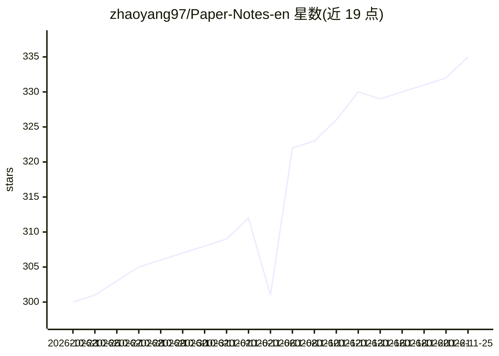

# zhaoyang97/Paper-Notes-en

⭐ 335 · Python · NOASSERTION · 推送 2026-11-19 · [GitHub](https://github.com/zhaoyang97/Paper-Notes-en) · [官网](https://en.papernotes.org) · 组织维护

**AI 顶会论文速读笔记库：5 分钟读一篇顶会论文**

聚合 23,000+ 篇 AI·LLM·NLP·CV 顶会论文笔记的在线阅读站点，覆盖 ACL、CVPR、ICLR、NeurIPS 等 11 个会议，按 55 个研究方向（3D 视觉、LLM 推理、Agent、RLHF、RAG 等）以文件夹组织，目录中附各会议完整论文列表 Markdown，站点提供全文检索，持续更新并公布后续会议收录路线图。内容以 CC BY-NC-SA 4.0 许可发布，禁止商用；用户可通过 issue 或邮件反馈修订请求。

## 筛选速览

| 维度 | 判定 | 备注 |
|---|---|---|
| AI 角色 | `ai-knowledge` | 知识聚合/清单类 |
| 许可风险 | `none` | NOASSERTION |
| 部署形态 | `None` |  |
| 模型依赖 | — | README 未给出锁定关系 |
| 硬件要求 | — | 无带数字的原话,不猜 |
| 安装摩擦 | `low` | 无编译、无系统依赖或容器化 |
| 成熟度 | — | 结构信号不足 |

## 能力要点

- 23,000+ 篇顶会论文笔记，覆盖 11 个会议并持续更新
- 按 55 个研究方向文件夹组织，各方向附条目数量
- 提供各会议完整论文列表 Markdown 文件
- 在线站点支持全文检索

## 适用场景

- 快速了解某篇顶会论文的核心内容
- 按研究方向浏览追踪最新论文
- 检索特定主题是否有顶会论文涉及

## 场景标签

`科研工具` `精选清单` · 领域:学习与行业

## 证据(README 行号)

> L8: **Read a top-tier AI paper in 5 minutes — one repo to keep up with the latest AI progress.**
> L10: - 📖 **23,000+** AI · LLM · NLP · CV top-venue paper notes
> L12: - 🔬 Spans LLM Reasoning · VLM · Agent · RLHF · RAG · AIGC · Robotics and 55 research areas

## 星数曲线

2026-10-23 300 → 2026-11-25 335（+35）

---
*卡片 v1 · prompt 1.4 · 生成 2026-11-25 · 置信度 high · 依据 README sha `7348cf1c2ac7` · [字段定义](../../DATASET.md)*
