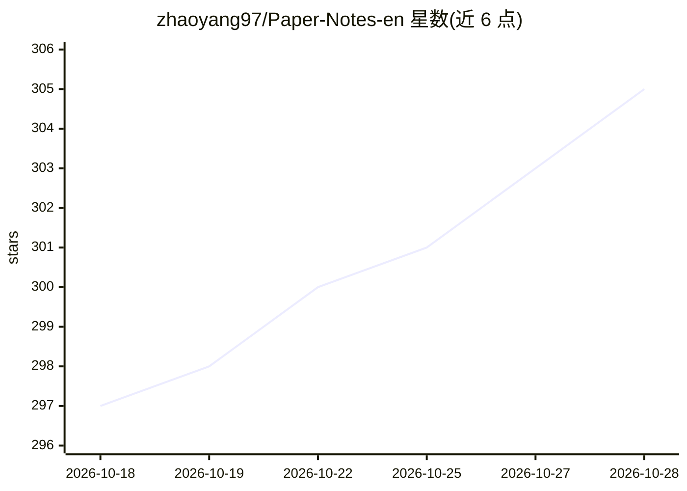

# zhaoyang97/Paper-Notes-en

⭐ 306 · Python · NOASSERTION · 推送 2026-09-18 · [GitHub](https://github.com/zhaoyang97/Paper-Notes-en) · [官网](https://en.papernotes.org) · 个人维护

**面向研究者的顶会 AI 论文笔记聚合库，覆盖 23,000+ 篇**

由个人维护的 AI 论文笔记聚合仓库：收录 ACL、CVPR、ICLR、NeurIPS、ICML、AAAI、ICCV、ECCV 等顶会 23,000 余篇论文的 5 分钟阅读笔记，按 55 个研究方向（LLM 推理、VLM、Agent、RLHF、RAG、机器人等）以文件夹组织。提供在线阅读站点 en.papernotes.org（含全文搜索），笔记随会议录取名单持续更新，Roadmap 列出后续将覆盖的会议。许可为 CC BY-NC-SA 4.0，禁止商用且衍生需同许可共享。

## 筛选速览

| 维度 | 判定 | 备注 |
|---|---|---|
| AI 角色 | `ai-knowledge` | 知识聚合/清单类 |
| 许可风险 | `none` | NOASSERTION |
| 部署形态 | `None` |  |
| 模型依赖 | — | README 未给出锁定关系 |
| 硬件要求 | — | 无带数字的原话,不猜 |
| 安装摩擦 | `low` | 无编译、无系统依赖或容器化 |
| 成熟度 | — | 结构信号不足 |

## 能力要点

- 23,000+ 顶会论文笔记，覆盖 8 个以上会议
- 55 个研究方向文件夹组织条目
- 在线站点支持全文搜索
- 持续更新并公示后续会议覆盖计划

## 适用场景

- 快速了解某篇顶会论文的核心内容
- 按研究方向浏览某领域近期论文进展
- 追踪 ICLR/CVPR/NeurIPS 等会议的论文列表

## 场景标签

`精选清单` `科研工具` · 领域:学习与行业

## 证据(README 行号)

> L8: **Read a top-tier AI paper in 5 minutes — one repo to keep up with the latest AI progress.**
> L10: - 📖 **23,000+** AI · LLM · NLP · CV top-venue paper notes

## 星数曲线

2026-10-18 297 → 2026-10-28 305（+8）

---
*卡片 v1 · prompt 1.4 · 生成 2026-10-21 · 置信度 high · 依据 README sha `8ba5daee1612` · [字段定义](../../DATASET.md)*
