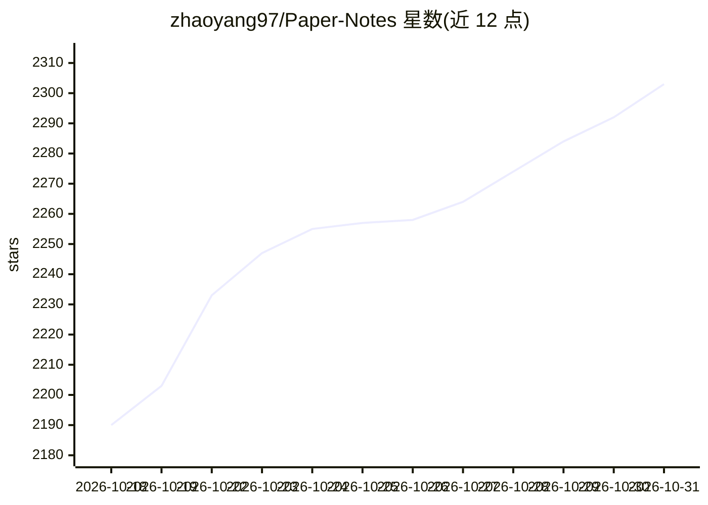

# zhaoyang97/Paper-Notes

⭐ 2,303 · Python · NOASSERTION · 推送 2026-10-03 · [GitHub](https://github.com/zhaoyang97/Paper-Notes) · [官网](https://papernotes.org) · 组织维护 · 中文 README

**面向研究者的顶会论文解读聚合站，23,000+ 篇覆盖 9 大会议**

收录 23,000+ 篇 AI/LLM/NLP/CV 顶会论文解读的内容仓库，覆盖 ECCV、ICML、ACL、CVPR、ICLR、AAAI、NeurIPS、ICCV 等会议，按 40 多个研究方向（3D 视觉、LLM 推理、强化学习、医学图像等）以文件夹组织笔记，提供在线阅读站点 papernotes.org，持续按会议更新版本。内容以 CC BY-NC-SA 4.0 授权，允许收录申请与下架请求。适合需要快速跟踪顶会进展的研究者与学生阅读使用，非可运行代码项目。

## 筛选速览

| 维度 | 判定 | 备注 |
|---|---|---|
| AI 角色 | `ai-knowledge` | 知识聚合/清单类 |
| 许可风险 | `none` | NOASSERTION |
| 部署形态 | `None` |  |
| 模型依赖 | — | README 未给出锁定关系 |
| 硬件要求 | — | 无带数字的原话,不猜 |
| 安装摩擦 | `low` | 无编译、无系统依赖或容器化 |
| 成熟度 | — | 结构信号不足 |

## 能力要点

- 23,000+ 篇论文解读，覆盖 9 个顶会会议
- 40+ 研究方向分类，含各方向笔记数统计
- 提供在线阅读站点 papernotes.org，含全站搜索
- 版本化持续更新（v1.0.0 至 v1.6.0）

## 适用场景

- 5 分钟快速了解某篇顶会论文的核心思想
- 按研究方向浏览某领域近期顶会工作
- 会议录用后跟踪最新论文清单与解读

## 场景标签

`精选清单` · 领域:学习与行业

## 证据(README 行号)

> L9: - 📖 **23000+** 篇 AI · LLM · NLP · CV 顶会论文解读
> L11: - 🔬 横跨 LLM Reasoning · VLM · Agent · RLHF · RAG · AIGC · Robotics · Auto Driving 等40多个研究方向

## 星数曲线

2026-10-18 2,190 → 2026-10-31 2,303（+113）

---
*卡片 v1 · prompt 1.4 · 生成 2026-10-21 · 置信度 high · 依据 README sha `9a4faf46ddc7` · [字段定义](../../DATASET.md)*
