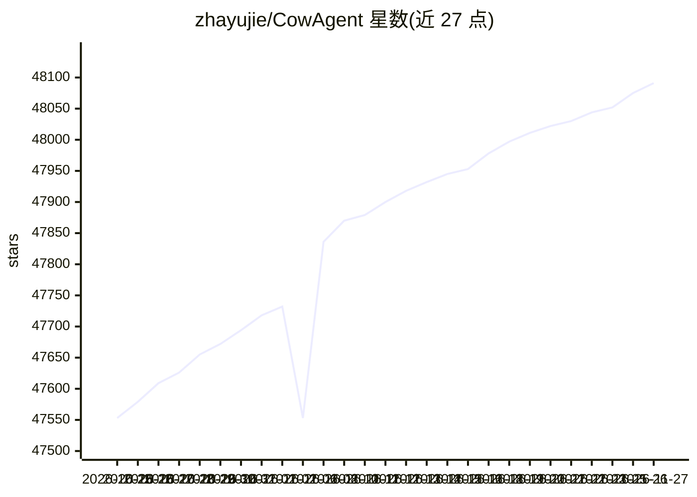

# zhayujie/CowAgent

⭐ 48,091 · Python · MIT · 推送 2026-11-26 · [GitHub](https://github.com/zhayujie/CowAgent) · [官网](https://cowagent.ai) · 个人维护 · 中文 README

**开源个人 AI 助手与 Agent Harness：规划任务、调用工具并随使用自我进化**

面向个人用户的开源 AI 助手，同时是一个可扩展的 Agent Harness：Agent Core 规划并分步执行任务，循环调用内置工具与技能直至达成目标。三层记忆架构（上下文/每日/核心）配合夜间 Deep Dream 提炼，自动整理知识为 Markdown wiki 与知识图谱，并具备 Self-Evolution 机制。支持多 Agent 协作、多模型路由（聊天/视觉/图像生成/ASR/TTS/嵌入可分别指定供应商）、多渠道接入（Web 控制台及十余个 IM 平台），提供一行脚本安装、Docker、桌面客户端、移动 App 与云端实例多种使用方式。

## 筛选速览

| 维度 | 判定 | 备注 |
|---|---|---|
| AI 角色 | `ai-native` | 本体是模型或模型工具 |
| 许可风险 | `permissive` | MIT |
| 部署形态 | `self-host` | docker 或自建部署 |
| 模型依赖 | locked-api |  |
| 硬件要求 | — | 无带数字的原话,不猜 |
| 安装摩擦 | `low` | 无编译、无系统依赖或容器化 |
| 成熟度 | — | 结构信号不足 |

## 动量与使用信号

- 维护:`active` — 距上次 push 1.9 天,年发版 22,157 位贡献者
- 涨星:近 1 天 **+13**(自 20261016 起算)
- 平台:WINDOWS / MACOS / LINUX · 协议:MCP

## 能力要点

- 三层长期记忆架构与夜间 Deep Dream 记忆提炼，混合关键词+向量检索
- 多 Agent 团队：每个 Agent 有独立角色、模型、技能与知识，共享会话协作
- 内置 10+ 工具并原生集成 MCP 协议（stdio/SSE、热重载）
- Skill Hub 一键安装技能，或通过对话生成自定义技能

## 适用场景

- 在电脑或服务器上 24/7 运行个人 AI 助手，通过微信/飞书/Telegram 等随时对话
- 让助手自动整理日常对话中的信息，形成个人知识库与知识图谱
- 组合多个工具与技能自动完成复杂任务
- 为不同能力（聊天/视觉/语音）分别接入不同模型供应商

## 场景标签

`AI 助手` `Agent 记忆` `多智能体` `知识图谱` · 领域:Agent 开发

## 证据(README 行号)

> L14: **CowAgent** is your own open-source personal AI agent. It plans tasks proactively, uses tools, skills and MCP, and
> L53: CowAgent is a complete **Agent Harness**: messages flow in through **Channels**; the **Agent Core** plans and reaso
> L123: CowAgent supports all mainstream LLM providers. **Chat, vision, image generation, ASR/TTS, and embeddings** can ea

## 星数曲线

2026-10-25 47,553 → 2026-11-27 48,091（+538）

---
*卡片 v1 · prompt 1.4 · 生成 2026-11-27 · 置信度 high · 依据 README sha `4b8cf67e98ed` · [字段定义](../../DATASET.md)*
