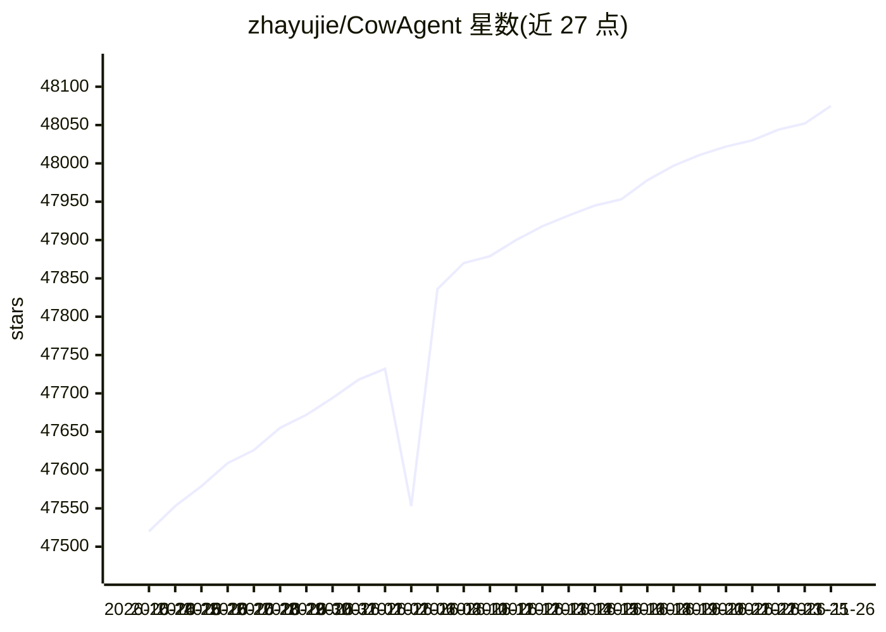

# zhayujie/CowAgent

⭐ 48,075 · Python · MIT · 推送 2026-11-25 · [GitHub](https://github.com/zhayujie/CowAgent) · [官网](https://cowagent.ai) · 个人维护 · 中文 README

**开源自托管个人 AI 助手：任务规划、工具技能调用与记忆进化**

一个可 24/7 运行在个人电脑或服务器上的开源个人 AI Agent：核心流程为消息经多渠道（Web、微信、飞书、Telegram 等 12+ IM）接入，Agent Core 基于三层长期记忆、个人知识库和工具/技能进行任务规划与推理，再由接入的大模型生成回复。支持多 Agent 协作、MCP 协议集成、技能市场一键安装、自然语言创建技能、自进化机制（Deep Dream 记忆蒸馏、知识图谱维护）。提供一行脚本安装、Docker、桌面客户端、移动端 App 与云服务多种使用方式，通过 Web 控制台统一配置。MIT 许可。

## 筛选速览

| 维度 | 判定 | 备注 |
|---|---|---|
| AI 角色 | `ai-ecosystem` | LLM/agent 周边工具 |
| 许可风险 | `permissive` | MIT |
| 部署形态 | `self-host` | docker 或自建部署 |
| 模型依赖 | locked-api |  |
| 硬件要求 | — | 无带数字的原话,不猜 |
| 安装摩擦 | `low` | 无编译、无系统依赖或容器化 |
| 成熟度 | — | 结构信号不足 |

## 动量与使用信号

- 维护:`active` — 距上次 push 1.9 天,年发版 22,157 位贡献者
- 涨星:近 1 天 **+13**(自 20261016 起算)
- 平台:WINDOWS / MACOS / LINUX · 协议:MCP

## 能力要点

- 任务规划分解、循环调用工具直至达成目标，内置 10+ 工具与 MCP 集成
- 三层记忆架构（上下文→每日→核心）与自动知识图谱维护
- 接入 12+ IM 渠道，多 Agent 团队协作
- Skill Hub 技能市场与对话式技能创作

## 适用场景

- 在微信/飞书/Telegram 等即时通讯里 24/7 使用个人 AI 助手
- 让 Agent 规划并执行复杂多步任务（文件、终端、浏览器、搜索）
- 搭建多 Agent 团队按角色分工协作
- 积累个人知识库与长期记忆并自动整理成 wiki

## 场景标签

`AI 助手` `Agent 记忆` `多智能体` `知识图谱` · 领域:Agent 开发

## 证据(README 行号)

> L14: **CowAgent** is your own open-source personal AI agent. It plans tasks proactively, uses tools, skills and MCP, and
> L53: CowAgent is a complete **Agent Harness**: messages flow in through **Channels**; the **Agent Core** plans and reaso
> L121: ## 🤖 Models

## 星数曲线

2026-10-24 47,520 → 2026-11-26 48,075（+555）

---
*卡片 v1 · prompt 1.4 · 生成 2026-11-26 · 置信度 high · 依据 README sha `888ed1152ae5` · [字段定义](../../DATASET.md)*
