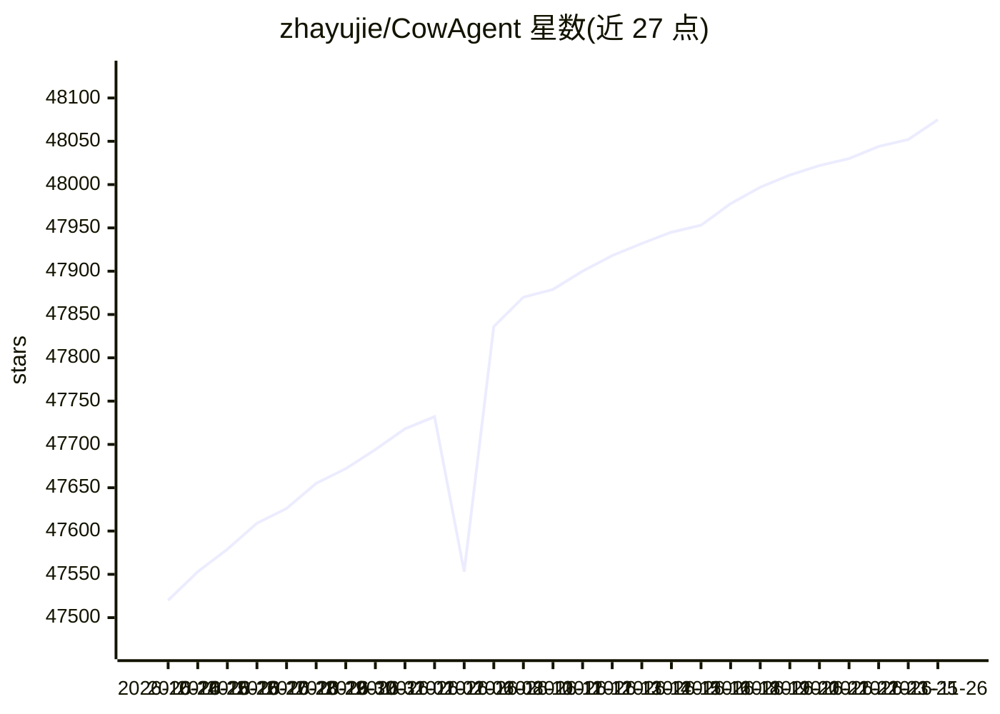

# zhayujie/CowAgent

⭐ 48,075 · Python · MIT · 推送 2026-11-25 · [GitHub](https://github.com/zhayujie/CowAgent) · [官网](https://cowagent.ai) · 个人维护 · 中文 README

**个人 AI 助手：规划任务、调用工具技能，长期记忆自我进化**

开源个人 AI 助手与 Agent Harness。消息经多渠道（Web、微信、飞书、钉钉、Telegram 等 12+ 渠道）接入，Agent Core 基于三层记忆、个人知识库与工具/技能做任务规划与循环执行，模型层支持多家 LLM 按能力（对话/视觉/语音/嵌入）分路由。提供一键安装脚本、Docker、桌面客户端与 Web 控制台，可用 cow CLI 管理服务、安装技能。技能可从 Skill Hub、GitHub 等来源一键安装或经对话生成；MCP 以 mcp.json 集成，支持 stdio/SSE 与热加载。

## 筛选速览

| 维度 | 判定 | 备注 |
|---|---|---|
| AI 角色 | `ai-native` | 本体是模型或模型工具 |
| 许可风险 | `permissive` | MIT |
| 部署形态 | `self-host` | docker 或自建部署 |
| 模型依赖 | locked-api |  |
| 硬件要求 | — | 无带数字的原话,不猜 |
| 安装摩擦 | `low` | 无编译、无系统依赖或容器化 |
| 成熟度 | — | 结构信号不足 |

## 动量与使用信号

- 维护:`active` — 距上次 push 1.9 天,年发版 22,157 位贡献者
- 涨星:近 1 天 **+13**(自 20261016 起算)
- 平台:WINDOWS / MACOS / LINUX · 协议:MCP

## 能力要点

- 任务规划循环执行，支持多 Agent 团队协作
- 三层记忆架构（context→daily→core）+ Deep Dream 夜间蒸馏
- 内置文件/终端/浏览器/搜索等 10+ 工具，原生 MCP 集成
- 聊天/视觉/生图/ASR/TTS/嵌入可分路由到不同厂商模型

## 适用场景

- 在微信/飞书/Telegram 等渠道部署 24/7 个人助理
- 让助手记住我的偏好并持续跟进未完成任务
- 通过对话创建自定义技能并发布到技能市场
- 用 Web 控制台一键切换模型服务商

## 场景标签

`AI 助手` `Agent 记忆` `多智能体` `编码 Agent` · 领域:Agent 开发

## 证据(README 行号)

> L14: **CowAgent** is your own open-source personal AI agent. It plans tasks proactively, uses tools, skills and MCP, and
> L52: CowAgent is a complete **Agent Harness**: messages flow in through **Channels**; the **Agent Core** plans and reaso

## 星数曲线

2026-10-24 47,520 → 2026-11-26 48,075（+555）

---
*卡片 v1 · prompt 1.4 · 生成 2026-11-22 · 置信度 high · 依据 README sha `8c749bac697f` · [字段定义](../../DATASET.md)*
