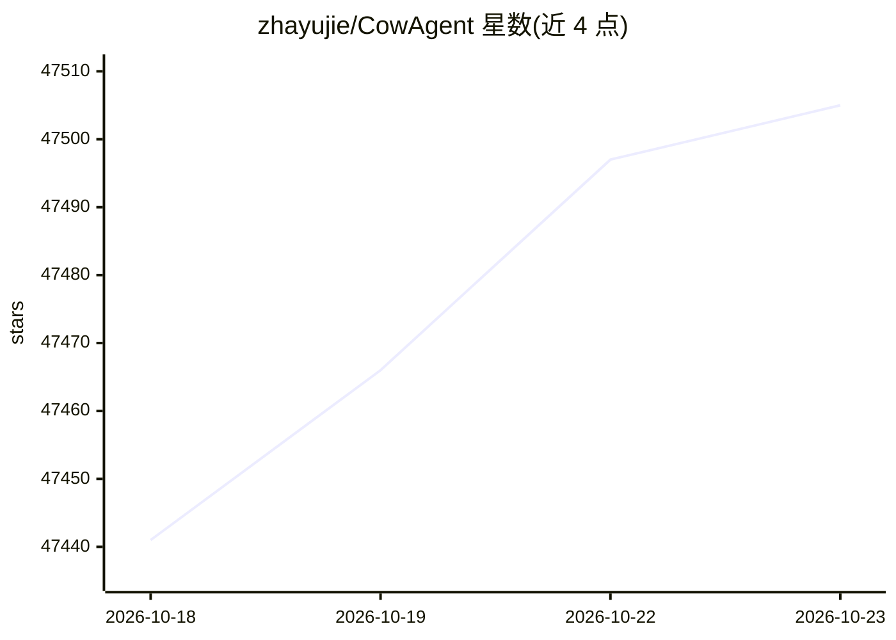

# zhayujie/CowAgent

⭐ 47,505 · Python · MIT · 推送 2026-10-22 · [GitHub](https://github.com/zhayujie/CowAgent) · [官网](https://cowagent.ai) · 个人维护 · 中文 README

**个人 AI 助手框架：任务规划、工具技能、多渠道接入**

CowAgent 是一个开源自托管个人 AI 助手/Agent Harness 参考实现：消息经 Channels 接入，Agent Core 基于记忆、知识与工具进行任务规划与执行，模型层生成回复。三层记忆架构（上下文→日→长期）加夜间 Deep Dream 蒸馏，自动维护 Markdown 知识库与知识图谱，支持 Skill Hub 一键装技能、MCP 协议接入工具，Web 控制台统一配置。提供一行安装脚本、Docker、桌面客户端，可 24/7 运行于个人电脑或服务器。

## 筛选速览

| 维度 | 判定 | 备注 |
|---|---|---|
| AI 角色 | `ai-native` | 本体是模型或模型工具 |
| 许可风险 | `permissive` | MIT |
| 部署形态 | `self-host` | docker 或自建部署 |
| 模型依赖 | locked-api |  |
| 硬件要求 | — | 无带数字的原话,不猜 |
| 安装摩擦 | `low` | 无编译、无系统依赖或容器化 |
| 成熟度 | — | 结构信号不足 |

## 动量与使用信号

- 维护:`active` — 距上次 push 1.9 天,年发版 22,157 位贡献者
- 涨星:近 1 天 **+13**(自 20261016 起算)
- 平台:WINDOWS / MACOS / LINUX · 协议:MCP

## 能力要点

- 三层记忆架构（上下文→每日→长期）与 Deep Dream 夜间蒸馏
- Skill Hub/GitHub/对话式生成技能，原生 MCP 集成（stdio/SSE，热重载）
- 内置 10+ 工具（文件、终端、浏览器自动化、搜索、调度等）
- 多渠道并行：Web、微信、飞书、钉钉、Telegram、Slack 等 12 种

## 适用场景

- 在个人电脑或服务器上长期运行自己的 AI 助手
- 通过微信/飞书/钉钉等 IM 与助手对话并执行任务
- 让助手自动整理对话为个人知识库与长期记忆
- 通过 MCP 与自定义 Skill 扩展助手能力

## 场景标签

`AI 助手` `Agent 记忆` `知识图谱` · 领域:Agent 开发

## 证据(README 行号)

> L14: **CowAgent** is an open-source super AI assistant that proactively plans tasks, controls your computer and external
> L52: CowAgent is a complete **Agent Harness**: messages flow in through **Channels**; the **Agent Core** plans and reaso
> L172: **MCP protocol** integrates the open ecosystem of Model Context Protocol servers. A single `mcp.json` is enough — 

## 星数曲线

2026-10-18 47,441 → 2026-10-23 47,505（+64）

---
*卡片 v1 · prompt 1.4 · 生成 2026-10-18 · 置信度 high · 依据 README sha `81940e341e1f` · [字段定义](../../DATASET.md)*
