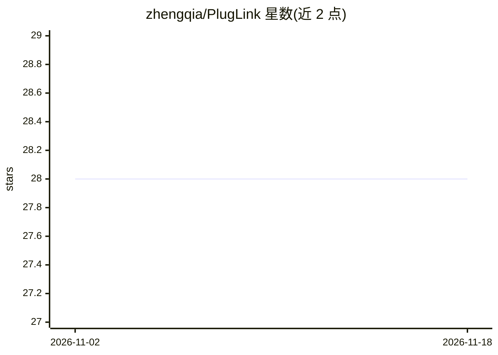

# zhengqia/PlugLink

⭐ 28 · JavaScript · MIT · 推送 2026-11-01 · [GitHub](https://github.com/zhengqia/PlugLink) · [官网](https://www.vicoco.cn) · 个人维护 · 中文 README

**链接脚本、API、AI大模型的全自动工作流平台，面向个人/小微企业**

PlugLink 是一套 Windows 桌面端自动化工作流框架：前端 layui、后端 Python、数据库 SQLite，通过网页界面操作。用户将插件放入 plugins 目录即可自动扫描加载，插件可自由组合成工作流实现 24 小时自动化运行；插件开发遵循 main.py/api.py/__init__.py 结构，依赖包独立存放于各插件 libs 目录。当前发布 1.0.0 beta 个人学习版（测试版，正式版时间未定），附带视频合成与视频相似度检测两个始发插件，应用商店尚无线上自动更新，插件需手动从飞书链接下载安装。README 上方还宣布网站已升级为 VicroCode 代码托管平台。

## 筛选速览

| 维度 | 判定 | 备注 |
|---|---|---|
| AI 角色 | `ai-ecosystem` | LLM/agent 周边工具 |
| 许可风险 | `permissive` | MIT |
| 部署形态 | `None` |  |
| 模型依赖 | — | README 未给出锁定关系 |
| 硬件要求 | — | 无带数字的原话,不猜 |
| 安装摩擦 | `low` | 无编译、无系统依赖或容器化 |
| 成熟度 | `idea` | |

## 能力要点

- 插件自由组合成全自动工作流，至少两个任务即可运行
- 支持链接脚本、API、AI大模型
- 插件开发标准结构（main.py/api.py/__init__.py），依赖独立于各插件 libs 目录
- 随附视频合成工具与视频相似度检测工具两个插件

## 适用场景

- 把多个插件串成自动化流程，实现无人值守办公
- 中小企业搭建自动化办公场景，降低开发成本
- 开发者按标准结构编写插件并分享给其他用户

## 场景标签

`工作流自动化` · 领域:效率与自动化

## 证据(README 行号)

> L45: PlugLink用于链接各种脚本、API、AI大模型，实现全自动工作流程。它可以显著降低应用层开发周期，帮助企业实现自动化办公，降本增效。PlugLink每个插件均可自由无序链接成不同的工作流并自动化运作，适应多种复杂工作场景。
> L170: 在这里可以创建全自动化工作流，将所有插件链接在一起，实现自动化运行。配置完成后，点击“测试工作流”，测试成功后即可运行。

## 星数曲线

2026-11-02 28 → 2026-11-18 28（+0）

---
*卡片 v1 · prompt 1.4 · 生成 2026-11-18 · 置信度 mid · 依据 README sha `2d05c48ee26a` · [字段定义](../../DATASET.md)*
