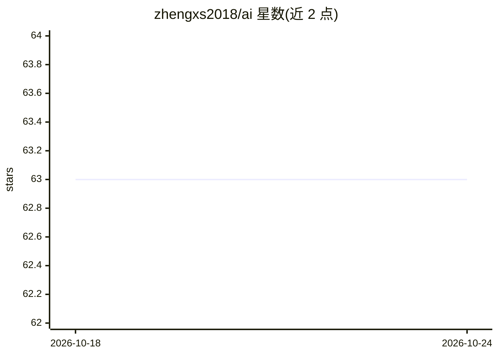

# zhengxs2018/ai

⭐ 63 · TypeScript · MIT · 推送 2026-08-11 · [GitHub](https://github.com/zhengxs2018/ai) · [官网](https://tsdocs.dev/docs/@zhengxs/ai/) · 个人维护 · 中文 README

**国内大模型 API 的统一 SDK，适配 OpenAI 输入输出格式**

TypeScript/npm 包 @zhengxs/ai，集成百度文心一言、阿里通义千问、讯飞星火、腾讯混元助手、Minimax、ImagineArt 等大模型 API，并将接口适配为 OpenAI 的输入与输出格式，流式调用方式与 OpenAI SDK 一致。面向需要在代码中统一接入多家国内模型的开发者，提供 API Key 配置后即可调用；另附本地开发流程（git clone + pnpm）与在线 Codespaces 方式。

## 筛选速览

| 维度 | 判定 | 备注 |
|---|---|---|
| AI 角色 | `ai-ecosystem` | LLM/agent 周边工具 |
| 许可风险 | `permissive` | MIT |
| 部署形态 | `library` | 以包/库形式分发 |
| 模型依赖 | — | README 未给出锁定关系 |
| 硬件要求 | — | 无带数字的原话,不猜 |
| 安装摩擦 | `low` | 无编译、无系统依赖或容器化 |
| 成熟度 | — | 结构信号不足 |

## 能力要点

- 集成文心一言、通义千问、讯飞星火、混元、Minimax 等多家模型 API
- 适配 OpenAI 输入与输出格式，流式用法与 OpenAI SDK 一致
- npm 包形式发布，pnpm install @zhengxs/ai 安装

## 适用场景

- 在 TypeScript 项目中统一接入多家国内大模型
- 复用 OpenAI SDK 调用习惯切换到国内模型
- 构建支持多模型后端的对话应用

## 场景标签

`模型网关` · 领域:Agent 开发

## 证据(README 行号)

> L3: 集成 百度文心一言，阿里通义千问，腾讯混元助手 和 讯飞星火认知 等国内大模型的 API，并且适配 OpenAI 的输入与输出。
> L48: $ pnpm install @zhengxs/ai

## 星数曲线

2026-10-18 63 → 2026-10-24 63（+0）

---
*卡片 v1 · prompt 1.4 · 生成 2026-10-24 · 置信度 high · 依据 README sha `64b87decdce3` · [字段定义](../../DATASET.md)*
