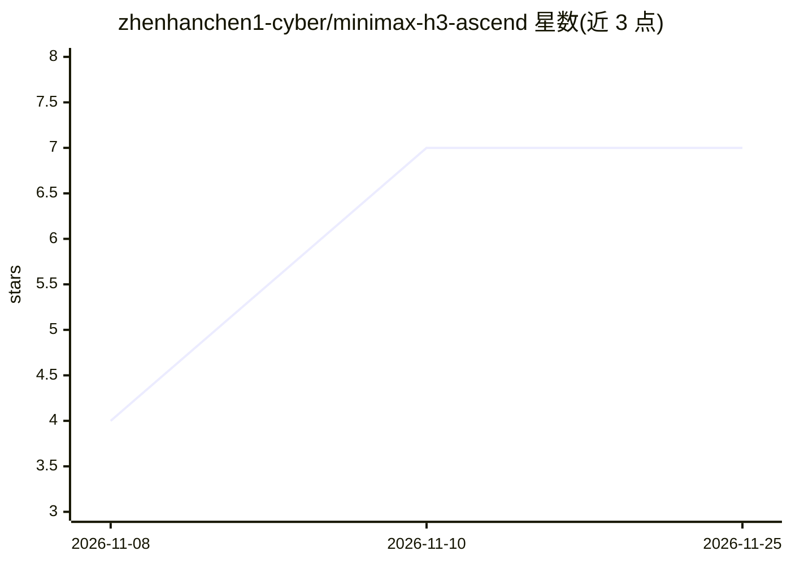

# zhenhanchen1-cyber/minimax-h3-ascend

⭐ 7 · Python · NOASSERTION · 推送 2026-10-13 · [GitHub](https://github.com/zhenhanchen1-cyber/minimax-h3-ascend) · [官网](https://gitcode.com/nxxwjbl/minimax-h3-nvidia-uncensored) · 个人维护 · 中文 README

**在昇腾 NPU 上本地部署 MiniMax-H3 视频生成的脚本方案**

提供在华为昇腾 910B/910C 上通过 ComfyUI 本地运行 MiniMax-H3 全模态视频模型的一套部署脚本与文档：setup.sh 一键安装、分片并行下载约 90GB 权重（实测聚合 40MB/s、支持断点续传）、启动脚本自动识别卡数并同步到工作流配置。覆盖文生视频、图生视频、参考图锁角色与音画同步输出，附实测性能表、17 条踩坑记录、32GB 单卡低配档方案与 10 个工作流 JSON。前提是环境已装 CANN ≥ 9.0.0 与 torch/torch_npu。脚本与文档采用 MIT 许可。

## 筛选速览

| 维度 | 判定 | 备注 |
|---|---|---|
| AI 角色 | `ai-native` | 本体是模型或模型工具 |
| 许可风险 | `permissive` | NOASSERTION |
| 部署形态 | `None` |  |
| 模型依赖 | — | README 未给出锁定关系 |
| 硬件要求 | `gpu-24g` | |
| 安装摩擦 | `medium` | 含编译或系统依赖之一 |
| 成熟度 | — | 结构信号不足 |

## 能力要点

- 三条命令完成部署：git clone + setup.sh + 下载/启动脚本
- 自研分片并行下载器，实测聚合 40MB/s 并支持断点续传
- 提供 1×32G / 1×64G / 2×64G / 4×64G 多档硬件适配配置
- 附实测性能表、17 条踩坑修复与昇腾兼容性判断

## 适用场景

- 在昇腾 910B 机器上本地跑 MiniMax-H3 生成视频
- 为昇腾环境快速下载约 90GB 的模型权重
- 在 32GB 显存的 910B 上按低配档方案出片
- 查找 H3 模型在昇腾上哪些量化权重可用

## 场景标签

`视频生成` · 领域:内容生成

## 证据(README 行号)

> L3: **在华为昇腾 NPU 上用 ComfyUI 本地跑 MiniMax-H3 全模态视频生成**
> L58: bash setup.sh                      # ① 装好一切（拉ComfyUI+打昇腾补丁+依赖+工作流）
> L60: bash scripts/start_comfyui.sh      # ③ 启动，浏览器打开 http://127.0.0.1:8188

## 星数曲线

2026-11-08 4 → 2026-11-25 7（+3）

---
*卡片 v1 · prompt 1.4 · 生成 2026-11-20 · 置信度 high · 依据 README sha `1206d9d7254c` · [字段定义](../../DATASET.md)*
