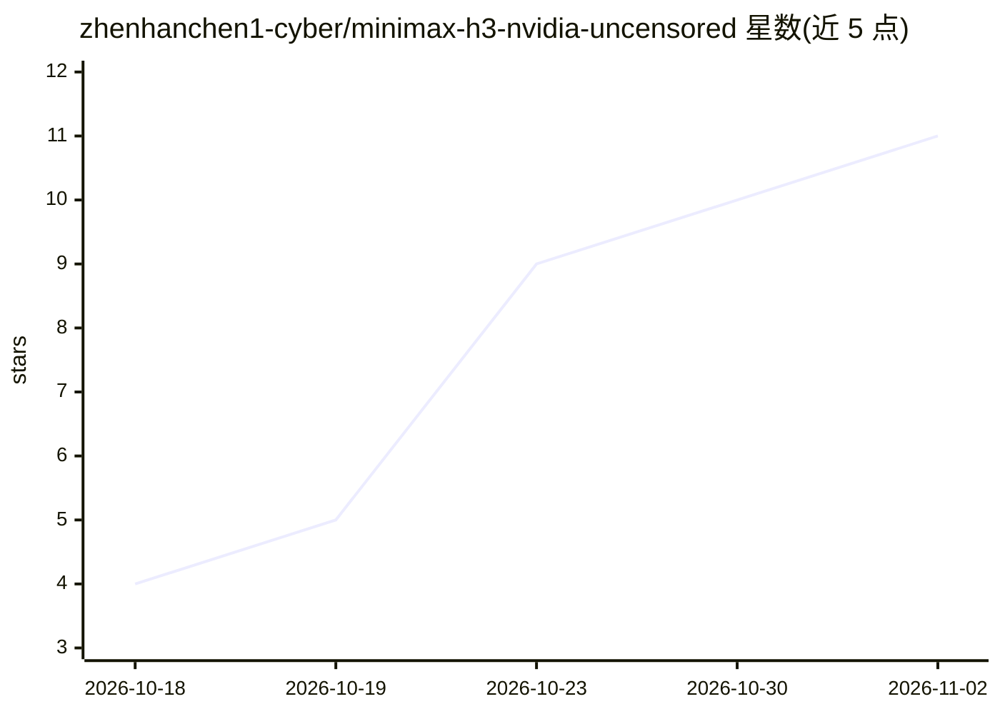

# zhenhanchen1-cyber/minimax-h3-nvidia-uncensored

⭐ 11 · Python · NOASSERTION · 推送 2026-10-13 · [GitHub](https://github.com/zhenhanchen1-cyber/minimax-h3-nvidia-uncensored) · [官网](https://gitcode.com/nxxwjbl/minimax-h3-ascend-uncensored) · 个人维护 · 中文 README

**MiniMax-H3 视频模型在 NVIDIA 卡（8GB 显存起）的本地部署脚本与工作流包**

面向本地视频生成用户的部署套件：install.sh 自动检测显卡与 torch 环境并安装 ComfyUI 及依赖节点，download.sh 按显存档位自动下载模型；收录 15+ 模型选型（GGUF 量化 Q2_K~Q5、融合 Turbo、fp8/NVFP4）与 9 套 ComfyUI 工作流，覆盖文生视频、图生视频、参考图锁角色三种玩法。附 4090-48G 真机实测数据、低显存卸载策略（GGUF 主模型 + safetensors 编码器 + RAM offload）与社区加速件可选安装。单次生成上限约 15 秒，磁盘需 ≥60GB。

## 筛选速览

| 维度 | 判定 | 备注 |
|---|---|---|
| AI 角色 | `ai-ecosystem` | LLM/agent 周边工具 |
| 许可风险 | `permissive` | NOASSERTION |
| 部署形态 | `library` | 以包/库形式分发 |
| 模型依赖 | — | README 未给出锁定关系 |
| 硬件要求 | `gpu-8g` | |
| 安装摩擦 | `medium` | 含编译或系统依赖之一 |
| 成熟度 | — | 结构信号不足 |

## 能力要点

- install.sh + download.sh 一键装环境并按显存档位自动下模型
- 8GB 显存起可跑：GGUF 量化主模型 + 内存卸载文本编码器
- 9 套 ComfyUI 工作流：文生/图生/参考图锁角色，含无 SLA 备用版
- 15+ 模型与 8 种文本编码器按显卡自选（含 GGUF 不可用于编码器的真机验证结论）

## 适用场景

- 在 8~24GB 显存的 N 卡上本地离线生成带音轨的视频
- 用参考图锁定人物/服装/画风生成剧情视频
- 低显存下用低分辨率生成加潜空间放大获得高清成片

## 场景标签

 · 领域:AI 视频生成/本地部署工具

## 证据(README 行号)

> L3: **在 NVIDIA 显卡上用 ComfyUI 本地跑 MiniMax-H3 全模态视频生成**
> L48:  **15+ 主模型 / 8 种文本编码器**全列出，按自己显卡挑；`install.sh` + `download.sh` 自动按显存选档
> L111: ```bash

## 星数曲线



2026-10-18 4 → 2026-11-02 11（+7）


---
*卡片 v1 · prompt 1.4 · 生成 2026-11-02 · 置信度 low · 依据 README sha `de05fd5fc18c` · [字段定义](../../DATASET.md)*
