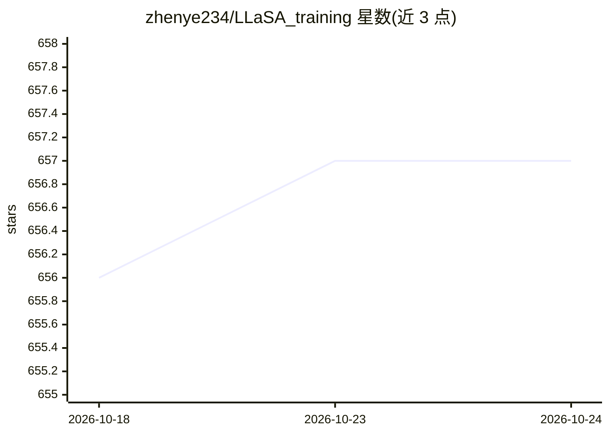

# zhenye234/LLaSA_training

⭐ 657 · Python · NOASSERTION · 推送 2026-01-21 · [GitHub](https://github.com/zhenye234/LLaSA_training) · 组织维护

**LLaMA 架构语音合成（TTS）模型的训练代码库**

提供 LLaSA（基于 LLaMA 的文本转语音）的训练与微调代码：用 torchrun 多卡或 Slurm 运行训练脚本，文本序列用 LLaMA 的 text tokenizer 编码，语音序列通过 X-codec2 提取，将语音 token 偏移后与文本 token 合并为统一 tokenizer。README 链接 arXiv 论文、Hugging Face 上的 codec 与推理模型集合，并指向约 16 万小时开源语音数据（LibriHeavy、Emilia、WenetSpeech4TTS）及社区基于 Verl 的 GRPO 微调脚本。面向语音合成方向的研究者与开发者。

## 筛选速览

| 维度 | 判定 | 备注 |
|---|---|---|
| AI 角色 | `ai-native` | 本体是模型或模型工具 |
| 许可风险 | `none` | NOASSERTION |
| 部署形态 | `None` |  |
| 模型依赖 | — | README 未给出锁定关系 |
| 硬件要求 | — | 无带数字的原话,不猜 |
| 安装摩擦 | `low` | 无编译、无系统依赖或容器化 |
| 成熟度 | — | 结构信号不足 |

## 能力要点

- LLaMA text tokenizer + X-codec2 语音 token 构成统一 tokenizer 的训练方案
- 支持 torchrun 多卡与 Slurm 两种训练启动方式
- 链接约 160,000 小时开源语音数据（LibriHeavy/Emilia/WenetSpeech4TTS）
- 提供 finetune 指南并收录社区 GRPO 微调结果

## 适用场景

- 复现或扩展 LLaMA 架构的语音合成模型训练
- 在 LibriHeavy、Emilia 等开源语音数据上训练 TTS
- 对 LLaSA 模型做多说话人微调

## 场景标签

 · 领域:语音合成/模型训练

## 证据(README 行号)

> L37: Text_sequence is encoded by the text tokenizer from Llama, for example, Llama-3.2-1B-Instruct
> L39: Speech_sequence is extrated through X-codec2 We change the value of speech tokens by adding len(text tokenizer) +8 

## 星数曲线

2026-10-18 656 → 2026-10-24 657（+1）

---
*卡片 v1 · prompt 1.4 · 生成 2026-10-22 · 置信度 high · 依据 README sha `64c981c6ed95` · [字段定义](../../DATASET.md)*
