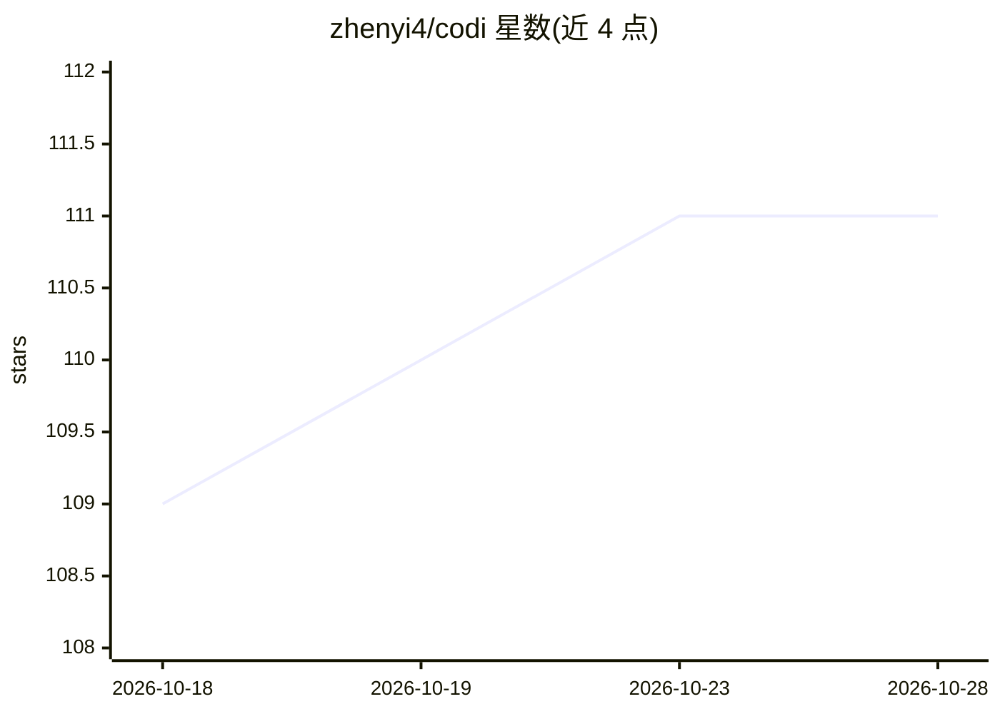

# zhenyi4/codi

⭐ 111 · Python · 推送 2025-12-15 · [GitHub](https://github.com/zhenyi4/codi) · [官网](https://arxiv.org/abs/2502.21074) · 组织维护

**EMNLP 2025 论文 CODI 官方实现：自蒸馏压缩思维链为连续潜变量**

论文《CODI: Compressing Chain-of-Thought into Continuous Space via Self-Distillation》的官方 PyTorch 实现。该方法通过自蒸馏将离散的思维链（CoT）压缩为连续空间中的潜思维（latent thoughts），并支持投影层、蒸馏损失类型与潜变量数量等关键训练参数配置。提供 Hugging Face 上的预训练权重（GPT-2、Llama 3.2 1B），可在 GSM8K/SVAMP/GSM-Hard/Multi-Arith 等数学基准及常识推理数据上评测、训练与探针可视化。面向复现实验或开展高效推理研究的科研人员。

## 筛选速览

| 维度 | 判定 | 备注 |
|---|---|---|
| AI 角色 | `ai-native` | 本体是模型或模型工具 |
| 许可风险 | `none` | — |
| 部署形态 | `library` | 以包/库形式分发 |
| 模型依赖 | — | README 未给出锁定关系 |
| 硬件要求 | — | 无带数字的原话,不猜 |
| 安装摩擦 | `low` | 无编译、无系统依赖或容器化 |
| 成熟度 | — | 结构信号不足 |

## 能力要点

- 自蒸馏将 CoT 压缩为连续潜思维，提供训练与推理脚本
- 预训练权重含 CODI-gpt2 与 CODI-llama3.2-1b-Instruct
- 支持 GSM8K 及 SVAMP/GSM-Hard/Multi-Arith 等 OOD 数学基准评测
- 提供潜思维探针与可视化脚本（论文第 5 节）

## 适用场景

- 复现论文中的压缩思维链训练与评测结果
- 在数学与常识推理基准上研究连续空间推理
- 探针分析模型潜思维的可解释性

## 场景标签

`科研工具` `模型训练` · 领域:学习与行业

## 证据(README 行号)

> L3: This is the official implementation of the paper: CODI: Compressing Chain-of-Thought into Continuous Space via Self-
> L25: Pretrained model weights are available at https://huggingface.co/zen-E, including:

## 星数曲线

2026-10-18 109 → 2026-10-28 111（+2）

---
*卡片 v1 · prompt 1.4 · 生成 2026-10-23 · 置信度 mid · 依据 README sha `39700218d706` · [字段定义](../../DATASET.md)*
