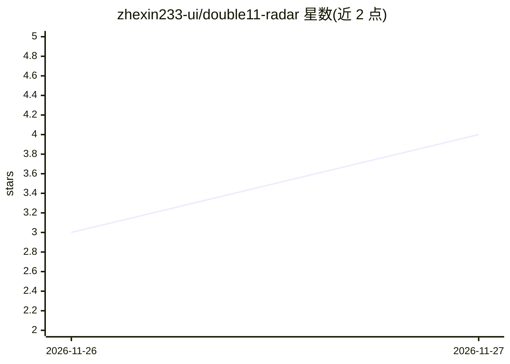

# zhexin233-ui/double11-radar

⭐ 4 · TypeScript · 推送 2026-11-25 · [GitHub](https://github.com/zhexin233-ui/double11-radar) · 个人维护 · 中文 README

**自托管双十一线报监控，AI 双级筛好价并推送**

部署在 NAS 或轻量服务器上的自托管系统：持续采集线报酷频道，先经一级语义初筛（兼容 TypeSafe Jev、Liquid d1.1、Laya 等协议端点，支持逐条/批次/正则三种模式），可选启用 OpenAI 兼容 LLM 的二级 Agent 深度核验（内置计算器、本地历史比价，可扩展 MCP Server 与自定义 HTTP 工具），命中后推送至 Bark 与飞书群。含密钥池管理、调用费用账本、SQLite 持久化与凭据加密。Docker Compose 部署，本地开发需 Node.js >= 22。

## 筛选速览

| 维度 | 判定 | 备注 |
|---|---|---|
| AI 角色 | `ai-enhanced` | 去掉 AI 部分产品仍成立 |
| 许可风险 | `none` | — |
| 部署形态 | `self-host` | docker 或自建部署 |
| 模型依赖 | — | README 未给出锁定关系 |
| 硬件要求 | — | 无带数字的原话,不猜 |
| 安装摩擦 | `low` | 无编译、无系统依赖或容器化 |
| 成熟度 | — | 结构信号不足 |

## 能力要点

- 一级语义初筛 + 可选二级 Agent 深度核验的双级筛选架构
- 密钥池容错自愈与跨级 Token/费用账本统计
- Bark 与飞书双渠道合并推送、跨频道防重
- SQLite WAL 持久化 + AES-256-GCM 凭据加密与自动清理

## 适用场景

- 在 NAS 上长期运行，自动监控线报酷好价并推送到手机
- 按自然语言购买需求（如只要原木浆抽纸）做语义匹配筛选
- 多模型渠道与密钥池管理，统计 LLM 调用费用

## 场景标签

`工作流自动化` `网页抓取` · 领域:效率与自动化

## 证据(README 行号)

> L5: 为双十一准备、也适合日常长期运行的自托管线报监控与智能筛选系统。
> L37: |**一级决策引擎**|兼容 TypeSafe Jev、Command Code、Liquid `d1.1` 及自建 Laya 等 SystemOne 协议端点；单条线报一次请求即可评估全部启用需求。|
> L40: |**二级深度核验（Agent）**|可选对一级命中（及待确认）线报触发 OpenAI 兼容 LLM 二次核验，输出折后实付、单价公式、凑单步骤、历史比价与风险提示。|

## 星数曲线

2026-11-26 3 → 2026-11-27 4（+1）

---
*卡片 v1 · prompt 1.4 · 生成 2026-11-26 · 置信度 mid · 依据 README sha `1383df3af325` · [字段定义](../../DATASET.md)*
