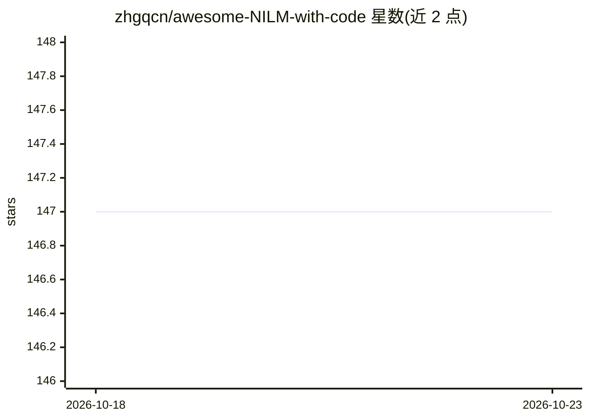

# zhgqcn/awesome-NILM-with-code

⭐ 147 · CC-BY-4.0 · 推送 2026-09-15 · [GitHub](https://github.com/zhgqcn/awesome-NILM-with-code) · 个人维护

**NILM 论文与代码策展清单：能源分解研究一站式索引**

面向非侵入式负荷监测（NILM）研究者的 awesome 类清单：收录每篇均附带代码的论文，按年份（2015–2026）分组为可折叠卡片，每条含标题、摘要段落与论文/代码徽章链接。另设工具包（NILMTK、NILMTK-Contrib 等）、数据集（17 个住宅、2 个商业、3 个工业、5 个合成）、会议、综述与部署等栏目。内容覆盖 Transformer、LLM 免训练 NILM、扩散模型增强等近期方向。仓库采用 CC BY 4.0 许可。

## 筛选速览

| 维度 | 判定 | 备注 |
|---|---|---|
| AI 角色 | `ai-knowledge` | 知识聚合/清单类 |
| 许可风险 | `viral` | CC-BY-4.0 |
| 部署形态 | `None` |  |
| 模型依赖 | — | README 未给出锁定关系 |
| 硬件要求 | — | 无带数字的原话,不猜 |
| 安装摩擦 | `low` | 无编译、无系统依赖或容器化 |
| 成熟度 | — | 结构信号不足 |

## 能力要点

- 按年份分组折叠的论文卡片，每条均附代码链接
- 收录 NILMTK、Torch-NILM 等 8 个工具包
- 收录 27 个真实数据集与 5 个合成数据生成器
- 覆盖 2025–2026 最新方向：LLM 免训练 NILM、扩散增强、多尺度注意力

## 适用场景

- 查找 NILM 领域附带代码的最新论文
- 为实验选择公开数据集与基准工具包
- 按年份回溯该领域经典与近期方法

## 场景标签

 · 领域:能源/智能电网研究

## 证据(README 行号)

> L3: **A curated list of Non-Intrusive Load Monitoring (NILM) papers — every entry ships with code.**
> L30: |**2026-09**|📦 Redesigned README into **modular, year-grouped cards** with badge links; older entries folded into c

## 星数曲线

2026-10-18 147 → 2026-10-23 147（+0）

---
*卡片 v1 · prompt 1.4 · 生成 2026-10-22 · 置信度 high · 依据 README sha `b645d10edc24` · [字段定义](../../DATASET.md)*
