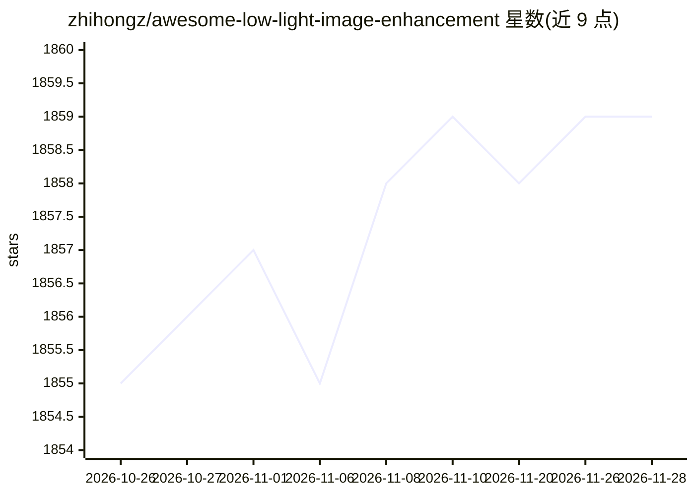

# zhihongz/awesome-low-light-image-enhancement

⭐ 1,859 · MATLAB · 推送 2026-11-02 · [GitHub](https://github.com/zhihongz/awesome-low-light-image-enhancement) · 个人维护

**低光照图像增强研究资源清单：数据集/论文/代码/指标**

面向低光照图像增强领域维护的资源汇总列表，内容分为数据集、综述与基准、方法三部分：数据集部分收录 SID、ExDARK、LOL、SICE 等 29 个数据集并附简介与链接；综述部分整理 2021-2023 年 5 篇综述与基准论文；方法部分按年份列出 2017 年以来的学习类方法论文及配套开源代码链接。README 通过 PR 接受社区补充，优先收录有开源代码的论文以便复现。

## 筛选速览

| 维度 | 判定 | 备注 |
|---|---|---|
| AI 角色 | `ai-knowledge` | 知识聚合/清单类 |
| 许可风险 | `none` | — |
| 部署形态 | `None` |  |
| 模型依赖 | — | README 未给出锁定关系 |
| 硬件要求 | — | 无带数字的原话,不猜 |
| 安装摩擦 | `low` | 无编译、无系统依赖或容器化 |
| 成熟度 | — | 结构信号不足 |

## 能力要点

- 收录 29 个低光照相关数据集并附简介与链接
- 按年份整理 2017 年以来的学习类增强方法论文与代码链接
- 收录 2021-2023 年 5 篇综述与基准论文

## 适用场景

- 查找低光照增强方向可用的训练与评测数据集
- 按年份梳理该领域深度学习方法的研究脉络
- 寻找论文对应的开源实现以复现结果

## 场景标签

`精选清单` · 领域:学习与行业

## 证据(README 行号)

> L3: **This is a resource list for low light image enhancement, including datasets, methods/codes/papers, metrics and so 
> L11: Low light imaging and low light image enhancement have wild applications in our daily life and different scientific
> L19: ## Datasets

## 星数曲线

2026-10-26 1,855 → 2026-11-28 1,859（+4）

---
*卡片 v1 · prompt 1.4 · 生成 2026-11-23 · 置信度 high · 依据 README sha `5f0e746ce9dc` · [字段定义](../../DATASET.md)*
