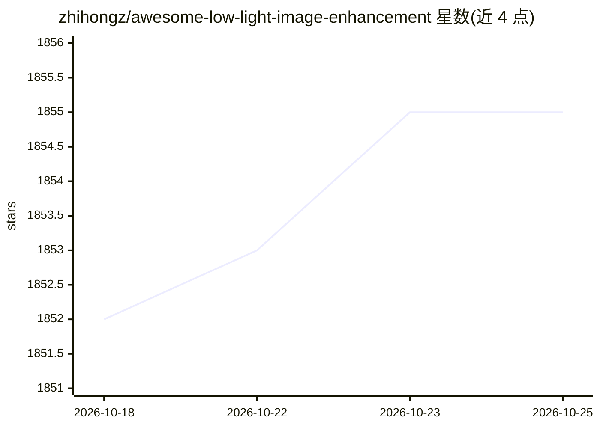

# zhihongz/awesome-low-light-image-enhancement

⭐ 1,855 · MATLAB · 推送 2026-05-12 · [GitHub](https://github.com/zhihongz/awesome-low-light-image-enhancement) · 个人维护

**低光照图像增强资源清单：数据集、方法/代码、综述与基准**

面向计算机视觉研究者与开发者的低光照图像增强（LLIE）资源汇总清单：收录约 30 个数据集（SID、ExDARK、LOL、VE-LOL 等）及其简介与链接、多篇综述与基准评测论文，以及按年份和发表会议/期刊组织的学习型与非学习型方法条目，每条含论文链接并在有开源代码时附代码链接（如 Retinex-Net、EnlightenGAN、Zero-DCE、URetinex-Net、SCI）。条目通过 PR 接受社区补充，优先收录有开源代码的论文以利于复现。本身不提供可安装运行的软件。

## 筛选速览

| 维度 | 判定 | 备注 |
|---|---|---|
| AI 角色 | `ai-knowledge` | 知识聚合/清单类 |
| 许可风险 | `none` | — |
| 部署形态 | `None` |  |
| 模型依赖 | — | README 未给出锁定关系 |
| 硬件要求 | — | 无带数字的原话,不猜 |
| 安装摩擦 | `low` | 无编译、无系统依赖或容器化 |
| 成熟度 | — | 结构信号不足 |

## 能力要点

- 收录约 30 个低光照数据集及简介与下载链接
- 按年份与发表venue组织的方法/论文/代码条目
- 含综述与基准评测论文栏目（2017-2023）
- 优先收录有开源代码的论文以支持复现

## 适用场景

- 为低光照增强研究挑选合适的数据集
- 按时间线梳理领域方法并获取对应开源代码
- 查找该方向的综述与基准评测论文

## 场景标签

`精选清单` · 领域:学习与行业

## 证据(README 行号)

> L3: **This is a resource list for low light image enhancement, including datasets, methods/codes/papers, metrics and so 
> L11: Low light imaging and low light image enhancement have wild applications in our daily life and different scientific

## 星数曲线

2026-10-18 1,852 → 2026-10-25 1,855（+3）

---
*卡片 v1 · prompt 1.4 · 生成 2026-10-21 · 置信度 high · 依据 README sha `485da75fad5a` · [字段定义](../../DATASET.md)*
