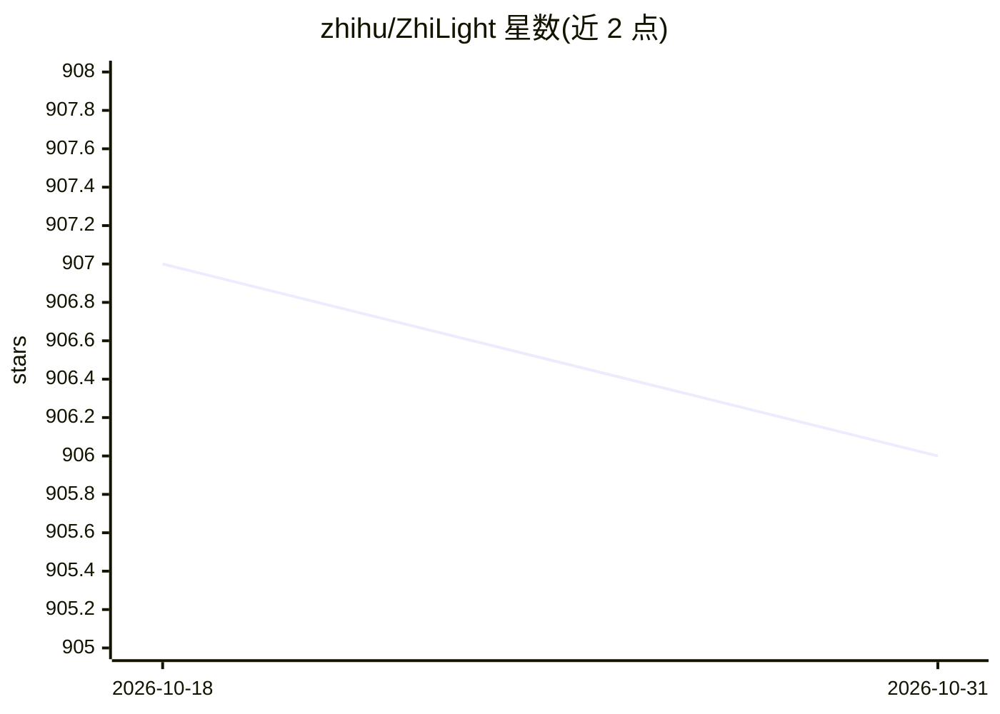

# zhihu/ZhiLight

⭐ 906 · C++ · Apache-2.0 · 推送 2026-03-18 · [GitHub](https://github.com/zhihu/ZhiLight) · 组织维护 · 中文 README

**知乎与面壁开发的 LLM 推理加速引擎，面向 PCIe GPU**

由知乎与 ModelBest 开发的 LLM 推理引擎，支持 Llama/Llama2、Llama3 系列、Mixtral、Qwen2 系列、DeepSeek-V3/R1 及 DeepSeek-VL2 多模态模型的推理加速。特性包括 OpenAI 兼容接口（改编自 vllm）、TP/PP 并行、动态批处理、chunked prefill、prefix cache、INT8/SmoothQuant/FP8/AWQ/GPTQ 量化与 MoE/MLA 支持。依赖 CUDA 运行时、cuBLAS 与 NCCL，提供源码编译 wheel 与 Docker 镜像两种方式，README 含与 vLLM、SGLang 的性能对比数据。

## 筛选速览

| 维度 | 判定 | 备注 |
|---|---|---|
| AI 角色 | `ai-ecosystem` | LLM/agent 周边工具 |
| 许可风险 | `permissive` | Apache-2.0 |
| 部署形态 | `self-host` | docker 或自建部署 |
| 模型依赖 | — | README 未给出锁定关系 |
| 硬件要求 | — | 无带数字的原话,不猜 |
| 安装摩擦 | `low` | 无编译、无系统依赖或容器化 |
| 成熟度 | — | 结构信号不足 |

## 能力要点

- OpenAI 兼容异步接口（改编自 vllm）
- INT8/SmoothQuant/FP8/AWQ/GPTQ 量化与 Marlin 内核
- TP/PP 并行、动态批处理、chunked prefill、prefix cache
- 支持 DeepSeek-V3/R1、Llama3、Qwen2、MoE 与 MLA

## 适用场景

- 在 PCIe GPU 服务器上部署 Llama/Qwen/DeepSeek 系列模型推理
- 多卡（TP/PP）环境部署大规模模型服务
- 对推理延迟和吞吐有要求的 LLM serving 场景

## 场景标签

`推理引擎` `模型量化` · 领域:训练与推理

## 证据(README 行号)

> L3: ✨ __ZhiLight__ ✨is a highly optimized LLM inference engine developed by Zhihu and ModelBest Inc. The "Zhi" in its na
> L15: * Asynchronous OpenAI compatible interface adapted from vllm

## 星数曲线

2026-10-18 907 → 2026-10-31 906（-1）

---
*卡片 v1 · prompt 1.4 · 生成 2026-10-21 · 置信度 high · 依据 README sha `56ce2b6dd0fa` · [字段定义](../../DATASET.md)*
