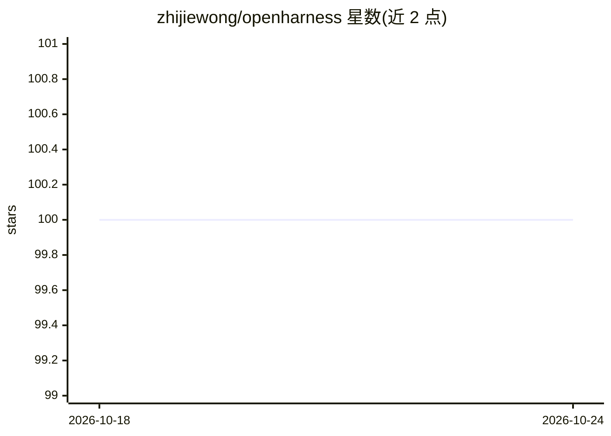

# zhijiewong/openharness

⭐ 100 · TypeScript · MIT · 推送 2026-05-12 · [GitHub](https://github.com/zhijiewong/openharness) · [官网](https://www.npmjs.com/package/@zhijiewang/openharness) · 个人维护 · 中文 README

**终端 AI 编程 agent：接入任意 LLM 辅助写代码**

基于 TypeScript/Node.js 18+ 的终端 AI 编程代理，支持本地 Ollama 模型或云端 API，无需 API key 即可自动检测本地模型启动对话。内置 44 个工具（Bash/文件编辑/子 agent/定时任务/MCP 资源/git worktree 等）、80 余个斜杠命令、7 级权限模式与 Bash AST 危险命令分析；每次 AI 编辑自动 git 提交可用 /undo 回滚。另提供 Python 与 TypeScript SDK 从程序内驱动，含会话恢复、流式事件与自定义工具。

## 筛选速览

| 维度 | 判定 | 备注 |
|---|---|---|
| AI 角色 | `ai-native` | 本体是模型或模型工具 |
| 许可风险 | `permissive` | MIT |
| 部署形态 | `library` | 以包/库形式分发 |
| 模型依赖 | local-ok | 支持本地模型 |
| 硬件要求 | — | 无带数字的原话,不猜 |
| 安装摩擦 | `low` | 无编译、无系统依赖或容器化 |
| 成熟度 | — | 结构信号不足 |

## 能力要点

- 44 个内置工具覆盖执行、编辑、子 agent、定时任务与 MCP
- 每次 AI 编辑自动 git 提交，/undo 可回滚
- 自动检测 Ollama 本地模型，无需 API key
- Python / TypeScript 官方 SDK 支持程序化调用

## 适用场景

- 在终端用本地或云端 LLM 完成代码编写与重构
- 通过子 agent 与 DAG 并行任务处理多步骤工程工作
- 在 notebook/流水线中用 SDK 批量驱动编程 agent

## 场景标签

`编码 Agent` · 领域:编码与开发

## 证据(README 行号)

> L12: AI coding agent in your terminal. Works with any LLM -- free local models or cloud APIs.
> L29: That's it. OpenHarness auto-detects Ollama and starts chatting. No API key needed.
> L52: Most AI coding agents are locked to one provider or cost $20+/month. OpenHarness works with any LLM -- run it free 

## 星数曲线

2026-10-18 100 → 2026-10-24 100（+0）

---
*卡片 v1 · prompt 1.4 · 生成 2026-10-23 · 置信度 high · 依据 README sha `10ca0354dc2b` · [字段定义](../../DATASET.md)*
