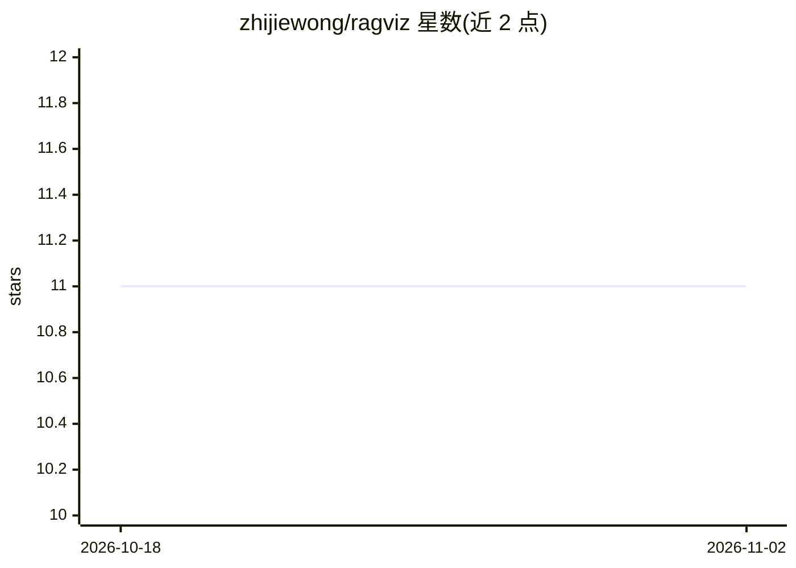

# zhijiewong/ragviz

⭐ 11 · TypeScript · MIT · 推送 2025-11-14 · [GitHub](https://github.com/zhijiewong/ragviz) · [官网](https://github.com/zhijiewong/ragviz) · 个人维护

**面向开发者的 Graph RAG 可视化与实时参数调优平台**

结合知识图谱与向量检索的 Graph RAG 可视化平台：支持上传 PDF/TXT 等文档、构建并交互浏览知识图谱，实时调整 Top K、相似度阈值、温度等参数并观察其对回答与子图结构的影响。集成本地 LLM（Ollama、llama.cpp），后端 FastAPI、前端 Next.js/React，数据存储用 Neo4j 及其 HNSW 向量索引。提供两条启动路径：Neo4j Aura 云端免费版 + 源码运行，或 Docker Compose 一体化本地部署。面向研究与数据科学团队。

## 筛选速览

| 维度 | 判定 | 备注 |
|---|---|---|
| AI 角色 | `ai-ecosystem` | LLM/agent 周边工具 |
| 许可风险 | `permissive` | MIT |
| 部署形态 | `self-host` | docker 或自建部署 |
| 模型依赖 | local-ok | 支持本地模型 |
| 硬件要求 | — | 无带数字的原话,不猜 |
| 安装摩擦 | `low` | 无编译、无系统依赖或容器化 |
| 成熟度 | — | 结构信号不足 |

## 能力要点

- 交互式知识图谱可视化（多种布局算法）
- 检索与生成参数（Top K/阈值/温度）实时调优并可视化影响
- Neo4j 向量索引结合图结构的混合检索
- 支持 Ollama、llama.cpp 等本地 LLM

## 适用场景

- 调 RAG 检索与生成参数并直观看到对回答的影响
- 上传文档构建并浏览知识图谱
- 本地 LLM 环境下搭建可调试的 Graph RAG 系统

## 场景标签

`RAG` `知识图谱` · 领域:知识与检索

## 证据(README 行号)

> L8: A developer-oriented Graph Retrieval-Augmented Generation (Graph RAG) visualization and parameter tuning platform. T
> L28: - 🔧 **Developer-Friendly** - Built for research and data science teams with debugging visualization

## 星数曲线

2026-10-18 11 → 2026-11-02 11（+0）

---
*卡片 v1 · prompt 1.4 · 生成 2026-11-01 · 置信度 high · 依据 README sha `0bd71d3dbbb3` · [字段定义](../../DATASET.md)*
