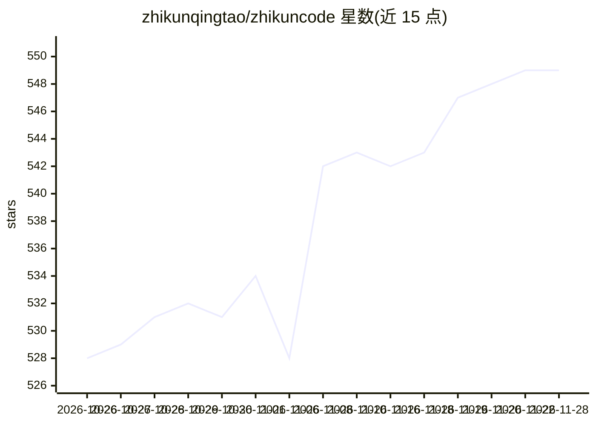

# zhikunqingtao/zhikuncode

⭐ 549 · Java · MIT · 推送 2026-11-23 · [GitHub](https://github.com/zhikunqingtao/zhikuncode) · [官网](https://zhikunqingtao.github.io/zhikuncode/) · 个人维护 · 中文 README

**自托管浏览器 AI 编程工作台，团队手机电脑协作长程任务**

自托管的 AI 编程工作台，将多 Agent 分工、上下文管理、工具执行与运行验证整合进浏览器界面；部署在自己服务器上，任何设备浏览器即可操作。五种子 Agent 角色并行执行，统一 Tool Gateway 授权安全架构，工具结果进入下一轮判断。支持 Docker 一键部署或本地三服务（JDK 21、Node 22+、Python 3.11/3.12）运行。MIT 许可，数据存本地；模型 API 与外部服务仍会接收请求中的数据。

## 筛选速览

| 维度 | 判定 | 备注 |
|---|---|---|
| AI 角色 | `ai-native` | 本体是模型或模型工具 |
| 许可风险 | `permissive` | MIT |
| 部署形态 | `self-host` | docker 或自建部署 |
| 模型依赖 | locked-api |  |
| 硬件要求 | — | 无带数字的原话,不猜 |
| 安装摩擦 | `low` | 无编译、无系统依赖或容器化 |
| 成熟度 | — | 结构信号不足 |

## 能力要点

- 浏览器全流程操控，电脑运行、手机接续同一会话
- 五种子 Agent 角色独立上下文与并行执行
- 统一 Tool Gateway 授权架构与 8 层安全检查流程
- 国产大模型直连：千问/DeepSeek/Moonshot/GLM/MiniMax 渠道配置

## 适用场景

- 团队自托管 AI 编程助手，数据不出本地机器
- 用手机远程跟进电脑上运行的编程任务
- 一句话生成网页游戏、办公文档等长程任务交付

## 场景标签

`编码 Agent` `多智能体` · 领域:Agent 开发

## 证据(README 行号)

> L5:  开源 AI 编程工作台 — 自托管，通过浏览器操作
> L29: ZhikunCode 将**多 Agent 分工、上下文管理、工具执行和运行验证**接入同一个浏览器工作台。模型读取项目、修改文件、执行命令，工具结果进入下一轮判断；你可以跟进子任务、检查修改，在运行中补充要求、处理审批或取消任务
> L250: |🇨🇳|**国产大模型直连**|可同时配置千问 / DeepSeek / Moonshot / 智谱GLM / MiniMax 等渠道，使用各自的 Key、端点和可用模型|

## 星数曲线

2026-10-26 528 → 2026-11-28 549（+21）

---
*卡片 v1 · prompt 1.4 · 生成 2026-11-25 · 置信度 mid · 依据 README sha `2500f7eb2f1c` · [字段定义](../../DATASET.md)*
