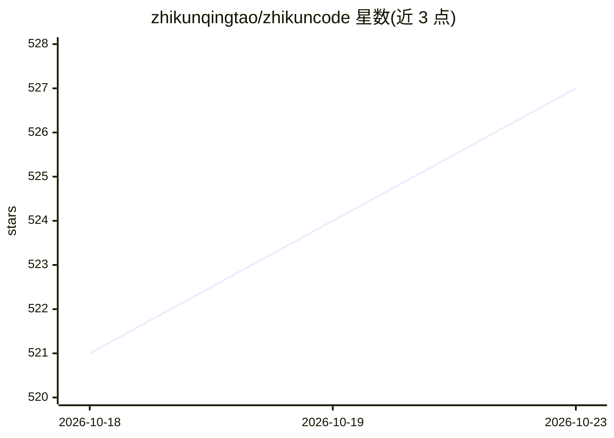

# zhikunqingtao/zhikuncode

⭐ 527 · Java · MIT · 推送 2026-10-19 · [GitHub](https://github.com/zhikunqingtao/zhikuncode) · [官网](https://zhikunqingtao.github.io/zhikuncode/) · 个人维护 · 中文 README

**自托管开源 AI 编程助手：浏览器/CLI 双入口完成长程任务**

Docker 自托管的 AI 编程助手，由 Java Agent Runtime、React 前端与 Python 服务组成；部署到服务器后用任意设备浏览器完成权限审批、任务管控与代码开发，手机可用。支持五种子 Agent 并行委派、六层上下文压缩级联、跨会话资料合并、Tool Gateway 统一授权与运行时验证框架；千问/DeepSeek/Moonshot/智谱GLM/MiniMax 国内直连，MIT 许可。默认 Docker Compose 部署（首建 15-30 分钟，建议 4GB+ 内存），本地开发需 JDK 21、Node.js 22+、Python 3.11~3.12；运行需自备 LLM API Key，可选 OSS 发布与语音功能需另行配置。

## 筛选速览

| 维度 | 判定 | 备注 |
|---|---|---|
| AI 角色 | `ai-native` | 本体是模型或模型工具 |
| 许可风险 | `permissive` | MIT |
| 部署形态 | `self-host` | docker 或自建部署 |
| 模型依赖 | locked-api |  |
| 硬件要求 | — | 无带数字的原话,不猜 |
| 安装摩擦 | `low` | 无编译、无系统依赖或容器化 |
| 成熟度 | — | 结构信号不足 |

## 能力要点

- 五种子 Agent 角色并行委派与后台任务管理
- 六层上下文压缩级联 + 自纠错循环应对超长对话
- Tool Gateway 统一授权：风险分析、Grant 匹配、执行前动态复检与结果审计
- 千问/DeepSeek/Moonshot/智谱GLM/MiniMax 国内网络直连

## 适用场景

- 团队在自己服务器部署 AI 编程环境，手机浏览器也能审批和管控任务
- 一句话驱动多 Agent 协作完成长程开发或办公任务
- 对 AI 工具执行过程做实时追踪、证据留存与运行时验证

## 场景标签

 · 领域:AI 编程助手/开发工具

## 证据(README 行号)

> L5:  开源 AI 编程助手 — 部署一次，浏览器全流程操控
> L137: |🇨🇳|**国产大模型直连**|千问 / DeepSeek / Moonshot / 智谱GLM / MiniMax 开箱即用，国内网络直连，无需科学上网|

## 星数曲线

2026-10-18 521 → 2026-10-23 527（+6）

---
*卡片 v1 · prompt 1.4 · 生成 2026-10-22 · 置信度 mid · 依据 README sha `d46b9368b13a` · [字段定义](../../DATASET.md)*
