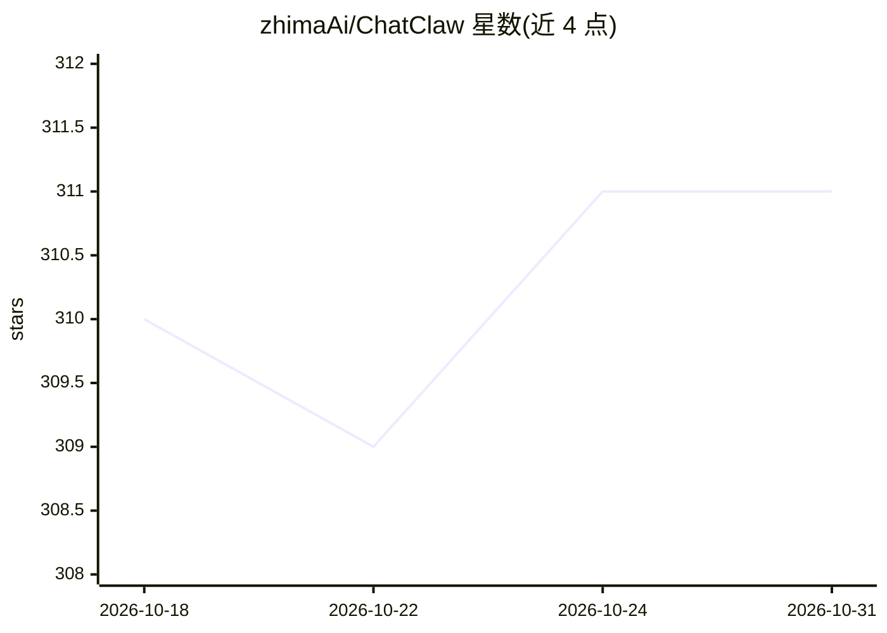

# zhimaAi/ChatClaw

⭐ 311 · Go · GPL-3.0 · 推送 2026-05-13 · [GitHub](https://github.com/zhimaAi/ChatClaw) · [官网](https://ichatclaw.com) · 组织维护 · 中文 README

**本地知识库个人 AI 智能体桌面应用，接入多聊天渠道**

基于 Wails v3（Go + WebView）的开源桌面应用，提供本地知识库管理（文档解析、向量嵌入、SQLite+sqlite-vec 检索）、多 Agent 模式、OpenClaw 5000+ 技能库与技能市场、定时任务、划词问答、智能侧边栏与一问多答等功能。可连接微信、钉钉、企业微信、QQ、飞书、WhatsApp、Telegram 等消息通道远程下发指令。支持 OpenAI、Claude、Gemini、Ollama、DeepSeek 等多家模型供应商，并可通过一键接入 ChatWiki 获得免费模型试用积分。另支持无 GUI 的服务器模式，以二进制或 Docker 运行，浏览器访问。

## 筛选速览

| 维度 | 判定 | 备注 |
|---|---|---|
| AI 角色 | `ai-native` | 本体是模型或模型工具 |
| 许可风险 | `viral` | GPL-3.0 |
| 部署形态 | `self-host` | docker 或自建部署 |
| 模型依赖 | local-ok | 支持本地模型 |
| 硬件要求 | — | 无带数字的原话,不猜 |
| 安装摩擦 | `low` | 无编译、无系统依赖或容器化 |
| 成熟度 | — | 结构信号不足 |

## 能力要点

- 本地知识库：文档自动解析、向量化与私有检索
- 接入微信/钉钉/飞书/WhatsApp 等多种消息通道远程控制
- 多 Agent 模式，各自独立角色、记忆与技能
- 服务器模式：Linux 二进制与 Docker 部署，浏览器访问

## 适用场景

- 在本地电脑搭建个人知识库问答助手
- 通过微信、钉钉等聊天工具远程让 AI 执行任务
- 定时抓取页面与监控数据源并在变化时推送提醒
- 创建多个不同角色的 AI Agent 处理不同任务场景

## 场景标签

`AI 助手` `文档问答` `多智能体` `网页抓取` · 领域:Agent 开发

## 证据(README 行号)

> L24: Chatclaw是一款开源的本地知识库、OpenClaw图形化桌面管家应用
> L32: 向 AI 助手提出任何问题，它会智能搜索您的知识库并生成相关回答。搭配内置技能市场，让 AI Agent 自主干活，无需人工全程干预。无论是复杂的项目规划、文档整理，还是 PPT 快速生成、多步骤任务执行，都能自主拆解，高效推进，
> L52: 一键授权接入 ChatWiki，同步 ChatWiki 账号积分，同时支持自定义模型，内置优质国内外大模型，Ollama、Google Gemini、OpenAI 等，无论是日常办公还是专业场景，使用您喜欢的 AI 模型。

## 星数曲线

2026-10-18 310 → 2026-10-31 311（+1）

---
*卡片 v1 · prompt 1.4 · 生成 2026-10-21 · 置信度 mid · 依据 README sha `0183932d1736` · [字段定义](../../DATASET.md)*
