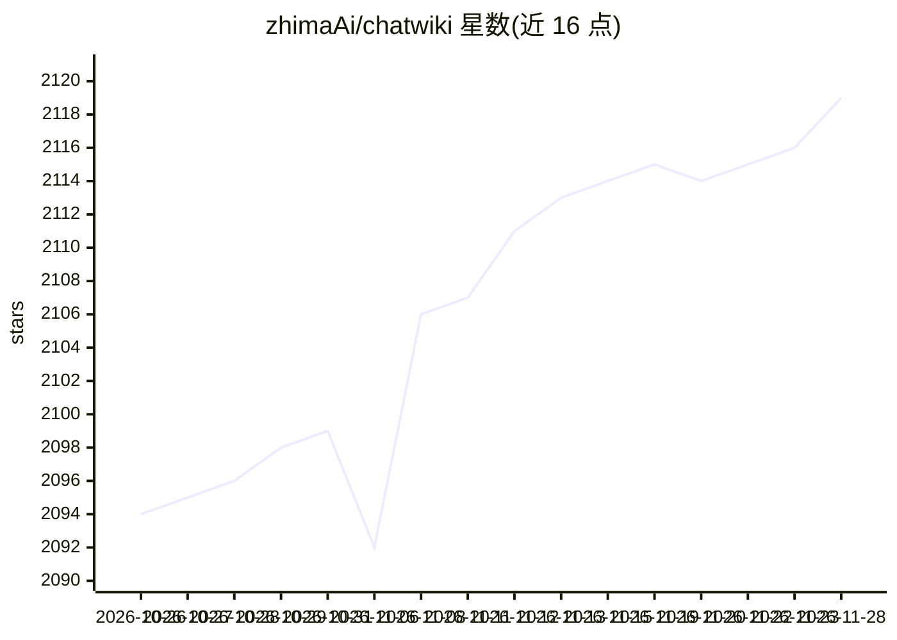

# zhimaAi/chatwiki

⭐ 2,119 · Vue · NOASSERTION · 推送 2026-11-27 · [GitHub](https://github.com/zhimaAi/chatwiki) · [官网](https://chatwiki.ai) · 组织维护 · 中文 README

**微信生态的工作流 Agent 平台：把公众号变成 AI 知识库客服**

面向微信公众号生态的工作流自动化平台：拖拽编排会话/插件工作流，接入公众号私聊、评论、关注等触发场景，支持自动回复、粉丝打标、文章改写与发布。内置文档与 QA 知识库（URL 读取、批量导入、AI 分段、混合检索），机器人处理常见咨询并支持转人工的多 Agent 协同分派。社区版通过 Docker 部署，技术栈为 vue.js + golang/python + PostgreSQL16/pgvector。日志中出现 [STD] 标记与 Free 版本说明。

## 筛选速览

| 维度 | 判定 | 备注 |
|---|---|---|
| AI 角色 | `ai-ecosystem` | LLM/agent 周边工具 |
| 许可风险 | `none` | NOASSERTION |
| 部署形态 | `None` |  |
| 模型依赖 | — | README 未给出锁定关系 |
| 硬件要求 | — | 无带数字的原话,不猜 |
| 安装摩擦 | `low` | 无编译、无系统依赖或容器化 |
| 成熟度 | — | 结构信号不足 |

## 能力要点

- 公众号触发场景（私聊/评论/关注/菜单）与自动回复工作流
- 文档与 QA 知识库：AI 分段、父子分段、混合检索
- 支持 20+ 主流模型（DeepSeek R1、OpenAI、Claude 等）
- 双向 MCP 集成与完整 OpenAPI，三层权限体系

## 适用场景

- 给未认证公众号配置自动回复 AI 客服
- 从公众号文章一键抓取建知识库
- 编排评论 AI 精选回复与文章一键改写
- 机器人接不住的咨询转人工协同处理

## 场景标签

`工作流自动化` `RAG` `多智能体` `聊天机器人` · 领域:Agent 开发

## 证据(README 行号)

> L10: ChatWiki is a workflow automation platform focused on the WeChat ecosystem, dedicated to making every official acco
> L33: - **Workflow Orchestration**: Conversational workflows, plugin workflows, including basic workflow nodes, bidirecti
> L45: - **Model Support**: Supports over 20 mainstream global models, including DeepSeek R1, doubao pro, qwen max, OpenAI

## 星数曲线

2026-10-26 2,094 → 2026-11-28 2,119（+25）

---
*卡片 v1 · prompt 1.4 · 生成 2026-11-28 · 置信度 high · 依据 README sha `bc4cc9d5b6cd` · [字段定义](../../DATASET.md)*
