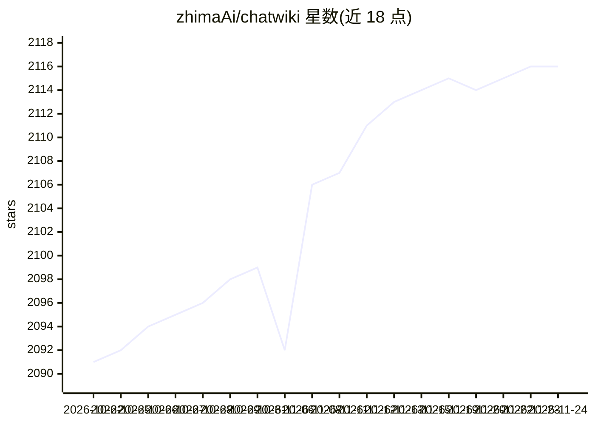

# zhimaAi/chatwiki

⭐ 2,116 · Vue · NOASSERTION · 推送 2026-11-20 · [GitHub](https://github.com/zhimaAi/chatwiki) · [官网](https://chatwiki.ai) · 组织维护 · 中文 README

**面向微信公众号生态的 AI 知识库工作流 Agent 平台**

ChatWiki 是一个聚焦微信生态的工作流自动化平台，通过拖拽方式将公众号变为 AI Agent，支持私聊自动回复、评论 AI 回复、文章一键改写等场景。核心机制包括：可视化工作流编排（含 MCP 双向接入与 Agent 模式）、文档与 QA 知识库（URL 读取、批量导入、混合检索）、机器人与人工客服协作。提供 Docker 部署的社区版，技术栈为 Vue.js 前端与 Golang+Python 后端，PostgreSQL16+pgvector 作向量与全文检索存储。更新日志中区分 [STD] 标注与社区版条目。

## 筛选速览

| 维度 | 判定 | 备注 |
|---|---|---|
| AI 角色 | `ai-ecosystem` | LLM/agent 周边工具 |
| 许可风险 | `none` | NOASSERTION |
| 部署形态 | `None` |  |
| 模型依赖 | — | README 未给出锁定关系 |
| 硬件要求 | — | 无带数字的原话,不猜 |
| 安装摩擦 | `low` | 无编译、无系统依赖或容器化 |
| 成熟度 | — | 结构信号不足 |

## 能力要点

- 拖拽式工作流编排，含基础节点、双向 MCP、Agent 模式与用户交互
- 文档/QA 知识库：URL 读取、批量导入、AI 分段、父子分段、混合检索
- 支持 20+ 主流模型接入（DeepSeek R1、doubao pro、qwen max、OpenAI、Claude 等）
- 多种部署与发布形态：桌面客户端、WebApp、网站与公众号嵌入

## 适用场景

- 为微信公众号搭建自动回复与 AI 客服机器人
- 从公众号文章抓取素材一键构建知识库
- 用可视化工作流编排内容生成与发布流程
- 机器人处理常见咨询、复杂问题转人工协作

## 场景标签

`工作流自动化` `RAG` `聊天机器人` `AI 写作` · 领域:效率与自动化

## 证据(README 行号)

> L33: - **Workflow Orchestration**: Conversational workflows, plugin workflows, including basic workflow nodes, bidirecti
> L45: - **Model Support**: Supports over 20 mainstream global models, including DeepSeek R1, doubao pro, qwen max, OpenAI
> L69: ChatWiki Community Edition is deployed using Docker and can be installed in just a few simple steps:

## 星数曲线

2026-10-22 2,091 → 2026-11-24 2,116（+25）

---
*卡片 v1 · prompt 1.4 · 生成 2026-11-23 · 置信度 high · 依据 README sha `0db4253c5737` · [字段定义](../../DATASET.md)*
