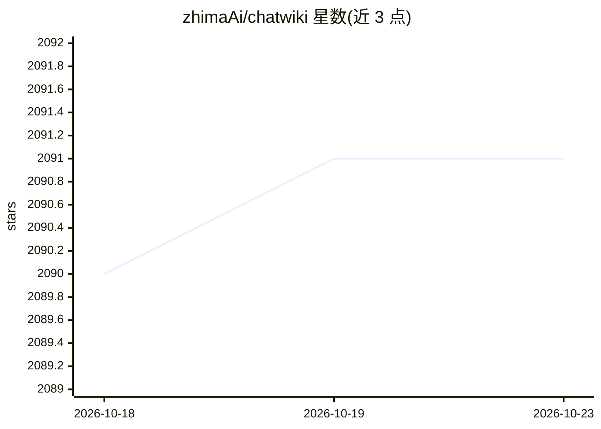

# zhimaAi/chatwiki

⭐ 2,091 · Vue · NOASSERTION · 推送 2026-10-16 · [GitHub](https://github.com/zhimaAi/chatwiki) · [官网](https://chatwiki.ai) · 组织维护 · 中文 README

**面向微信生态的 AI 知识库与工作流 Agent 平台**

ChatWiki 是聚焦微信公众号生态的工作流自动化平台：通过拖拽编排对话式工作流、插件工作流与 Agent 模式，整合公众号私信/评论/关注等触发场景，实现文章改写、AI 评论回复、私信自动应答。内置文档知识库（AI 分段、知识图谱、混合向量检索）、QA 知识库与人工客服转接，支持 20+ 主流模型接入，可发布为 WebApp、嵌入网站或公众号。社区版用 Docker 部署，技术栈为 vue.js + golang/python + PostgreSQL16/pgvector；另提供企业版/旗舰版云服务。

## 筛选速览

| 维度 | 判定 | 备注 |
|---|---|---|
| AI 角色 | `ai-ecosystem` | LLM/agent 周边工具 |
| 许可风险 | `none` | NOASSERTION |
| 部署形态 | `None` |  |
| 模型依赖 | locked-api |  |
| 硬件要求 | — | 无带数字的原话,不猜 |
| 安装摩擦 | `low` | 无编译、无系统依赖或容器化 |
| 成熟度 | — | 结构信号不足 |

## 能力要点

- 公众号私信/评论/关注等触发场景的拖拽式工作流编排
- 文档知识库支持 AI 分段、知识图谱、混合向量检索
- 支持 20+ 主流模型（DeepSeek R1、doubao pro、qwen max、OpenAI、Claude 等）
- 双向 MCP 集成与完整 OpenAPI 接口

## 适用场景

- 让微信公众号自动回复私信与评论，运营 AI 客服
- 抓取公众号文章一键构建知识库做问答
- 编排工作流生成与发布公众号文章

## 场景标签

`工作流自动化` `RAG` `文档问答` · 领域:效率与自动化

## 证据(README 行号)

> L10: ChatWiki is a workflow automation platform focused on the WeChat ecosystem, dedicated to making every official acco
> L33: - **Workflow Orchestration**: Conversational workflows, plugin workflows, including basic workflow nodes, bidirecti

## 星数曲线

2026-10-18 2,090 → 2026-10-23 2,091（+1）

---
*卡片 v1 · prompt 1.4 · 生成 2026-10-21 · 置信度 high · 依据 README sha `7d2b6997dea8` · [字段定义](../../DATASET.md)*
