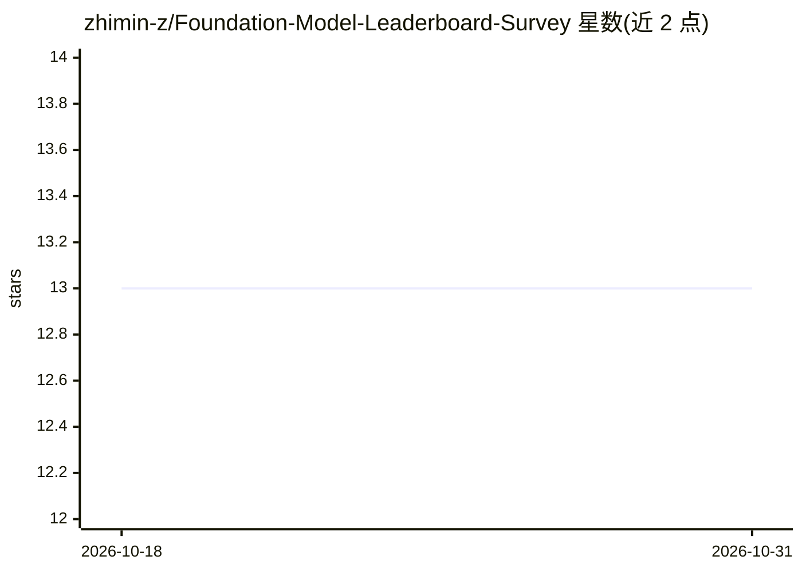

# zhimin-z/Foundation-Model-Leaderboard-Survey

⭐ 13 · Jupyter Notebook · 推送 2026-05-31 · [GitHub](https://github.com/zhimin-z/Foundation-Model-Leaderboard-Survey) · [官网](https://github.com/SAILResearch/awesome-ai-leaderboard) · 组织维护

**基础模型排行榜运营工作流与缺陷的探索性研究（附策展清单）**

发表于 IEEE Transactions on Software Engineering 的论文配套仓库：调查多个平台上的基础模型（FM）排行榜，聚焦其运营工作流（LBOps）与常见陷阱（leaderboard smells），并附带一个 FM 排行榜及相关工具与组织的策展清单。提供视频 teaser 介绍研究动机、方法与发现，配套 BibTeX 引用信息。面向软件工程与 AI 评测方向的研究人员。

## 筛选速览

| 维度 | 判定 | 备注 |
|---|---|---|
| AI 角色 | `ai-knowledge` | 知识聚合/清单类 |
| 许可风险 | `none` | — |
| 部署形态 | `None` |  |
| 模型依赖 | — | README 未给出锁定关系 |
| 硬件要求 | — | 无带数字的原话,不猜 |
| 安装摩擦 | `low` | 无编译、无系统依赖或容器化 |
| 成熟度 | — | 结构信号不足 |

## 能力要点

- 研究 FM 排行榜的运营工作流（LBOps）
- 总结排行榜常见陷阱（leaderboard smells）
- 附带 FM 排行榜及相关工具、组织的策展清单

## 适用场景

- 查找基础模型排行榜研究论文与引用信息
- 了解排行榜运营工作流与常见缺陷的分类
- 浏览策展的 FM 排行榜与工具清单

## 场景标签

`精选清单` `科研工具` · 领域:学习与行业

## 证据(README 行号)

> L14: Our paper investigates various foundation model (FM) leaderboards across multiple platforms, focusing on their oper
> L21: @article{zhao2024workflows,

## 星数曲线

2026-10-18 13 → 2026-10-31 13（+0）

---
*卡片 v1 · prompt 1.4 · 生成 2026-10-31 · 置信度 high · 依据 README sha `328a4b6a6352` · [字段定义](../../DATASET.md)*
