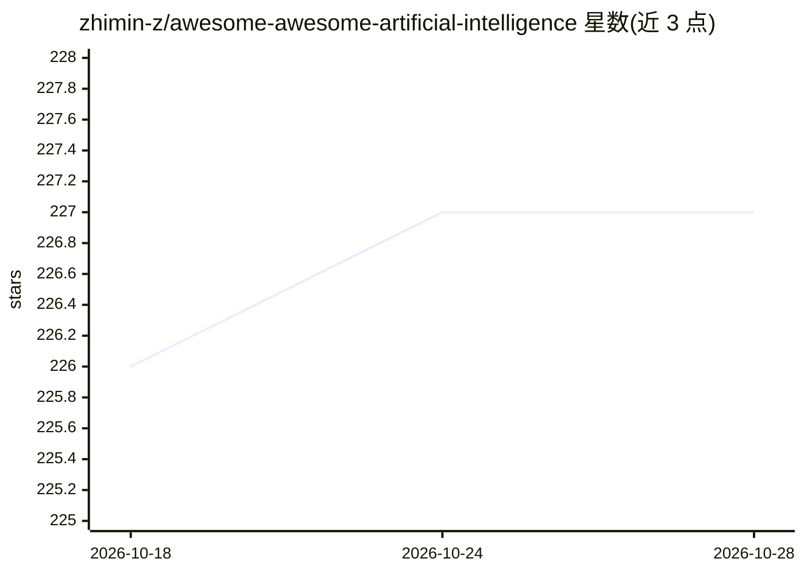

# zhimin-z/awesome-awesome-artificial-intelligence

⭐ 227 · MIT · 推送 2026-07-09 · [GitHub](https://github.com/zhimin-z/awesome-awesome-artificial-intelligence) · 个人维护

**AI 主题的 awesome 清单的清单，按主题分类编目**

由个人维护的二级策展清单：收录与人工智能相关的各类 awesome 清单，按通用、计算特定（对齐监管/AutoML/编译/压缩/可解释性/隐私安全/鲁棒性/系统生产）、学习范式（对抗/图/强化/监督学习）与领域特定（Agent/视觉/金融等）组织。收录门槛为不少于 1k stars 且 12 个月内活跃维护，条目以表格列出名称、简介与热度；接受 PR 与 issue 贡献，markdown 静态格式下不为一项清单分配多类别。

## 筛选速览

| 维度 | 判定 | 备注 |
|---|---|---|
| AI 角色 | `ai-knowledge` | 知识聚合/清单类 |
| 许可风险 | `permissive` | MIT |
| 部署形态 | `None` |  |
| 模型依赖 | — | README 未给出锁定关系 |
| 硬件要求 | — | 无带数字的原话,不猜 |
| 安装摩擦 | `low` | 无编译、无系统依赖或容器化 |
| 成熟度 | — | 结构信号不足 |

## 能力要点

- 收录条目为其他 awesome 清单而非具体项目
- 收录门槛：≥1k stars 且 12 个月内仍在维护
- 按通用/计算特定/学习范式/领域特定四级组织
- 每个清单仅归入单一类别

## 适用场景

- 按 AI 子领域查找进一步的主题清单
- 从二级索引定位特定方向（如 LLM 安全、MCP、扩散模型）的资源合集
- 为 AI 学习或选型调研寻找起点

## 场景标签

`精选清单` · 领域:学习与行业

## 证据(README 行号)

> L9: **Awesome Awesome Artificial Intelligence** contains many awesome topics closely related to artificial intelligence.
> L15: Also, a listed repository should be excluded if:

## 星数曲线

2026-10-18 226 → 2026-10-28 227（+1）

---
*卡片 v1 · prompt 1.4 · 生成 2026-10-22 · 置信度 high · 依据 README sha `1f43c63b8474` · [字段定义](../../DATASET.md)*
