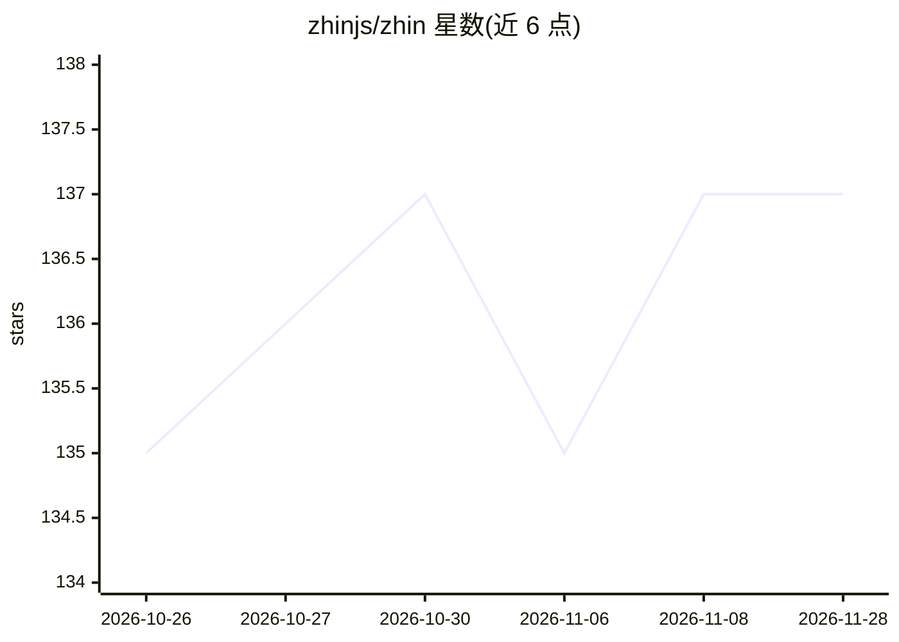

# zhinjs/zhin

⭐ 137 · TypeScript · MIT · 推送 2026-11-27 · [GitHub](https://github.com/zhinjs/zhin) · [官网](http://zhin.js.org/) · 组织维护 · 中文 README

**TypeScript 机器人框架：一套代码跑 20+ 聊天平台，可选 AI Agent**

面向聊天应用的 TypeScript 机器人框架：通过适配器将 QQ、微信、Discord、Telegram、Slack 等平台统一为单一消息模型，一套代码多平台运行；命令/中间件/工具以文件为单位自动注册，支持生成隔离的热重载。IM 核心 <10MB 且不依赖 LLM，AI Agent、工具、三层 Markdown 记忆与 MCP 通过 `npx zhin setup --ai` 按需启用，并带安全策略（权限、可见性、人工审批）。提供浏览器 Console 管理账户、权限、实例与日志，Node.js ≥22.19.0，MIT 许可。

## 筛选速览

| 维度 | 判定 | 备注 |
|---|---|---|
| AI 角色 | `ai-ecosystem` | LLM/agent 周边工具 |
| 许可风险 | `permissive` | MIT |
| 部署形态 | `library` | 以包/库形式分发 |
| 模型依赖 | local-ok | 支持本地模型 |
| 硬件要求 | — | 无带数字的原话,不猜 |
| 安装摩擦 | `low` | 无编译、无系统依赖或容器化 |
| 成熟度 | — | 结构信号不足 |

## 能力要点

- 一套代码适配 20+ 聊天平台（统一消息模型）
- 文件即功能：commands/middlewares/tools 等目录零样板自动注册
- 生成隔离热重载：新代码启动失败时旧版本继续服务
- 可选 AI Agent：MCP、自定义工具与安全策略，`npx zhin setup --ai` 启用

## 适用场景

- 为多个聊天平台维护同一个社区机器人
- 给群聊机器人添加受权限管控的 AI 助手与自定义工具
- 通过浏览器 Console 管理已部署机器人的账户、权限与日志

## 场景标签

`聊天机器人` · 领域:对话与助手

## 证据(README 行号)

> L54: Zhin.js is a TypeScript framework for **bots that live in chat apps** — community bots, personal assistants, notifi
> L59: - **Small by default (<10MB), AI when you want it.** The IM core needs no LLM dependencies. Add AI agents, tools, 3
> L114: |**AI Agent** *(optional)*|Answers messages no command matched and calls your tools|`tools/<name>/index.ts`, enabl

## 星数曲线

2026-10-26 135 → 2026-11-28 137（+2）

---
*卡片 v1 · prompt 1.4 · 生成 2026-11-28 · 置信度 high · 依据 README sha `0472344aa8f2` · [字段定义](../../DATASET.md)*
