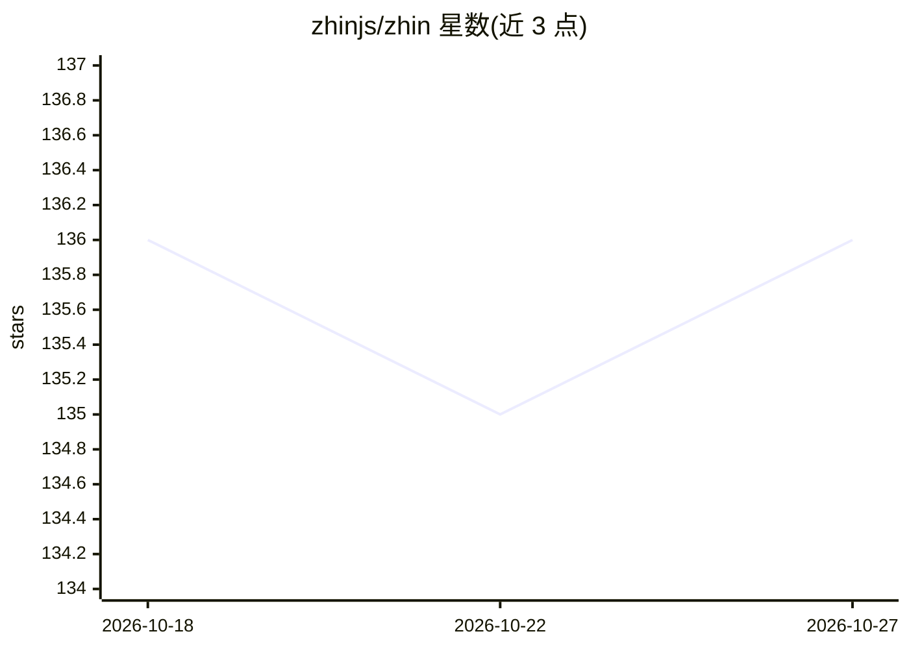

# zhinjs/zhin

⭐ 136 · TypeScript · MIT · 推送 2026-10-26 · [GitHub](https://github.com/zhinjs/zhin) · [官网](http://zhin.js.org/) · 组织维护 · 中文 README

**TypeScript 跨平台聊天 bot 框架，一套代码跑 20+ 平台**

用 TypeScript 编写聊天机器人的框架：适配器将 QQ、Discord、Telegram、Slack、微信等 20+ 平台的消息转换为统一格式，一套代码多平台运行。功能以文件为单位组织（命令/中间件/工具），支持热重载（新代码失败时旧版本继续服务），核心体积小于 10MB 且无需模型 key。AI 为可选层：通过 npx zhin setup --ai 安装 Agent 运行时，未命中命令的消息交给模型，支持工具调用、记忆、MCP 与框架级安全策略；浏览器控制台用于测试消息、日志与配置管理。要求 Node.js ≥22.19.0。

## 筛选速览

| 维度 | 判定 | 备注 |
|---|---|---|
| AI 角色 | `ai-ecosystem` | LLM/agent 周边工具 |
| 许可风险 | `permissive` | MIT |
| 部署形态 | `library` | 以包/库形式分发 |
| 模型依赖 | — | README 未给出锁定关系 |
| 硬件要求 | — | 无带数字的原话,不猜 |
| 安装摩擦 | `low` | 无编译、无系统依赖或容器化 |
| 成熟度 | — | 结构信号不足 |

## 能力要点

- 一套代码通过适配器运行于 20+ 聊天平台
- 可选 AI Agent 层：工具、记忆、MCP、框架级权限与审批策略
- 热重载失败时旧版本继续服务
- 浏览器控制台（console.zhin.dev）管理测试消息、日志与配置

## 适用场景

- 用一套 TypeScript 代码同时维护多个聊天平台的社区 bot
- 在无平台账号无模型 key 的 Sandbox 里本地开发调试 bot
- 为群聊/私聊 bot 增加可选的 LLM 智能回复与工具调用

## 场景标签

`Agent 框架` · 领域:Agent 开发

## 证据(README 行号)

> L29: Zhin.js is a framework for building **bots that live in chat apps** — community bots, personal assistants, notifica
> L33: - **Small by default, AI when you want it.** The IM core is under 10MB and needs no model key. Add LLMs, tools, mem
> L75: |**AI Agent** *(optional)*|Answers messages no command matched, and can call your tools|`tools/<name>/index.ts`, `a

## 星数曲线

2026-10-18 136 → 2026-10-27 136（+0）

---
*卡片 v1 · prompt 1.4 · 生成 2026-10-22 · 置信度 high · 依据 README sha `b29be9e75c79` · [字段定义](../../DATASET.md)*
