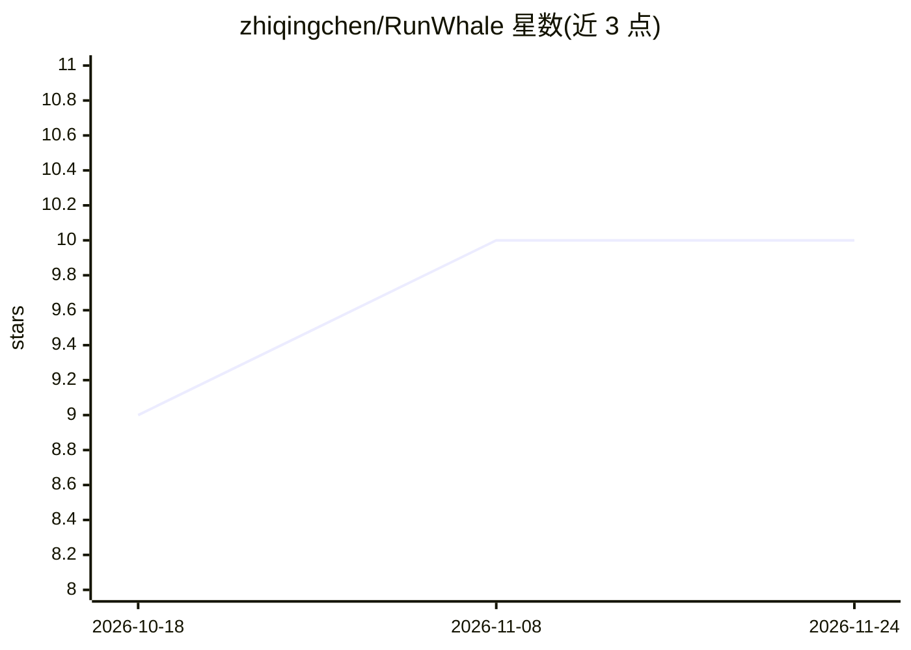

# zhiqingchen/RunWhale

⭐ 10 · TypeScript · Apache-2.0 · 推送 2026-11-21 · [GitHub](https://github.com/zhiqingchen/RunWhale) · [官网](https://runwhale.dev/) · 个人维护 · 中文 README

**在手机上创建、编辑、运行并迭代 Web 与 React Native 项目的编码 Agent**

RunWhale 是面向手机端的 AI 编码 Agent：用户可在移动设备上创建项目、导入 Git 仓库、让 Agent 编写/测试/修复代码并保存会话续接。项目文件、会话、工具、Git 与预览在设备本地运行；Agent 可运行有界的 Node.js/TypeScript 任务、安装受支持的纯 JavaScript 包，并通过具备视觉能力的模型检查日志与截图。范围限于 Expo SDK 57 项目，不提供通用 Linux shell/PTY、原生 npm 扩展或 IPA/APK 构建。采用 Apache License 2.0，第三方代码与资产保留原许可。

## 筛选速览

| 维度 | 判定 | 备注 |
|---|---|---|
| AI 角色 | `ai-native` | 本体是模型或模型工具 |
| 许可风险 | `permissive` | Apache-2.0 |
| 部署形态 | `None` |  |
| 模型依赖 | — | README 未给出锁定关系 |
| 硬件要求 | — | 无带数字的原话,不猜 |
| 安装摩擦 | `low` | 无编译、无系统依赖或容器化 |
| 成熟度 | — | 结构信号不足 |

## 能力要点

- 创建项目、导入 Git 仓库并审查变更
- Agent 编写、测试、修复代码，会话可保存续接
- 运行有界的 Node.js/TypeScript 任务并安装受支持的纯 JavaScript 包
- Web/iOS/Android 预览，Agent 可用视觉模型检查截图

## 适用场景

- 在手机上随时随地编写和调试 Web 或 React Native 项目
- 导入 Git 仓库后让 Agent 继续推进已有项目
- 在设备上预览 Expo 应用的运行效果

## 场景标签

`编码 Agent` · 领域:编码与开发

## 证据(README 行号)

> L5: RunWhale is an AI coding agent for your phone. Create, edit, and preview Web and React Native projects with local to
> L14: - Ask the Agent to write, test, and fix code, then resume work in saved sessions.
> L15: - Run bounded Node.js and TypeScript tasks and install supported pure-JavaScript packages.

## 星数曲线

2026-10-18 9 → 2026-11-24 10（+1）

---
*卡片 v1 · prompt 1.4 · 生成 2026-11-19 · 置信度 high · 依据 README sha `e6d229236cb3` · [字段定义](../../DATASET.md)*
