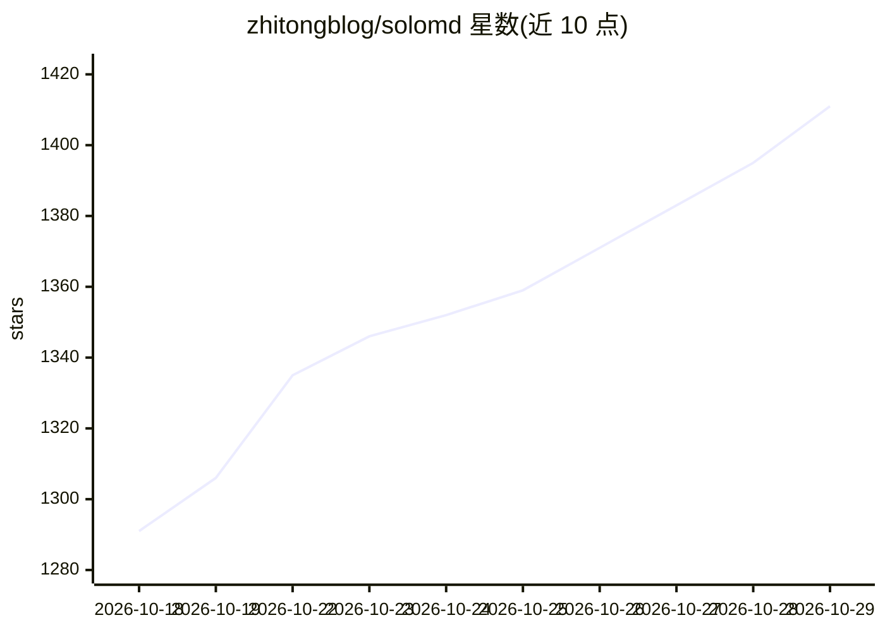

# zhitongblog/solomd

⭐ 1,411 · TypeScript · MIT · 推送 2026-10-28 · [GitHub](https://github.com/zhitongblog/solomd) · [官网](https://solomd.app) · 个人维护 · 中文 README

**本地优先的 Markdown 编辑器，内置 MCP 供外部 agent 驱动笔记库**

基于 Tauri 2 + Vue 3 + CodeMirror 6 的 Markdown 编辑器，笔记以 .md 文件存于本地文件夹。内置 solomd-mcp 服务器（16 个工具），可被 Claude Code / Cursor / Cline 等 MCP 客户端从外部驱动同一笔记库；编辑器内有 Agent 面板（对话、引用、Insert/Copy 落盘）与 YAML 声明式 recipes（cron/on-save/on-commit/on-tag-add 触发），每次 agent 写入落在独立 AutoGit 分支，接受后才合入 main。支持 14 个 AI 供应商 BYOK（密钥存 OS keychain），Ollama 自动探测。另有 4.6 版知识图谱层（YAML frontmatter 类型/关系、关系图、tldraw 白板）。MIT 许可，~15–32 MB。提供 macOS dmg、Windows msi、Linux AppImage/deb/rpm、iPad App Store 版本；受限之处：无订阅但需自带 AI key，Windows 7/8 不支持。

## 筛选速览

| 维度 | 判定 | 备注 |
|---|---|---|
| AI 角色 | `ai-enhanced` | 去掉 AI 部分产品仍成立 |
| 许可风险 | `permissive` | MIT |
| 部署形态 | `desktop` | 安装包/桌面程序 |
| 模型依赖 | local-ok | 支持本地模型 |
| 硬件要求 | — | 无带数字的原话,不猜 |
| 安装摩擦 | `low` | 无编译、无系统依赖或容器化 |
| 成熟度 | — | 结构信号不足 |

## 能力要点

- 内置 solomd-mcp 服务器（16 个 MCP 工具，stdio/HTTP，默认只读、--allow-write 可选）
- Agent 面板对话笔记库，回复可 Insert/Copy 到活动笔记
- 声明式 YAML recipes 支持 cron/on-save/on-commit/on-tag-add 触发，agent 写入落独立 AutoGit 分支后人工接受
- 14 个 AI 供应商 BYOK，密钥存 OS keychain；Ollama 本地自动探测
- 4.6 知识图谱层：类型化 frontmatter、关系图、保存的过滤视图、tldraw 白板

## 适用场景

- 用 Markdown 文件本地管理个人知识库，跨设备经 GitHub 私有仓库同步
- 让 Claude Code / Cursor 等外部 agent 通过 MCP 读写我的笔记库
- 定时跑 AI recipes（周报生成、TODO 提取、翻译、链接失效检查）并逐次审阅改动
- 在编辑器内直接与笔记对话，把回复插入当前笔记

## 场景标签

`知识库管理` `知识图谱` `文档问答` · 领域:知识与检索

## 证据(README 行号)

> L30: Your notes live in a folder. **SoloMD is the editor on top — with a first-class agent surface inside the editor, an
> L50: **The editor.** WYSIWYG live edit (Typora-style), tabs + split panes, KaTeX + Mermaid, image paste to `_assets/`, s
> L63: |**AI rewrite, BYOK**|14 providers — OpenAI · Claude · Gemini · DeepSeek · Qwen · GLM · Kimi · Doubao · SiliconFlow

## 星数曲线

2026-10-18 1,291 → 2026-10-29 1,411（+120）

---
*卡片 v1 · prompt 1.4 · 生成 2026-10-21 · 置信度 mid · 依据 README sha `536492f7e965` · [字段定义](../../DATASET.md)*
