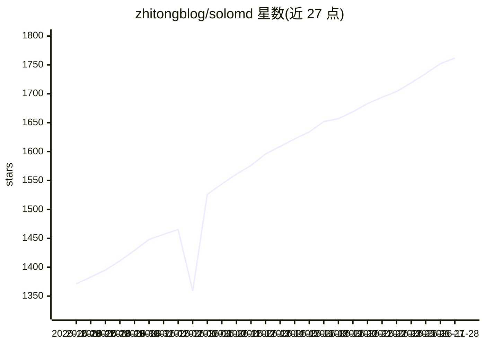

# zhitongblog/solomd

⭐ 1,762 · TypeScript · MIT · 推送 2026-11-27 · [GitHub](https://github.com/zhitongblog/solomd) · [官网](https://solomd.app) · 个人维护 · 中文 README

**本地优先的 Markdown 笔记编辑器，内置 MCP 服务器供 AI 客户端操作 vault**

基于 Tauri 2 + Vue 3 + Rust 的 Markdown 编辑器，覆盖 macOS/Windows/Linux/iOS/Android 五平台。提供 WYSIWYG/Live Preview/分屏三种写作模式、9 种格式导出、加密云与 Git 同步、AutoGit 快照、离线语义 RAG 搜索。AI 部分：内置 Agent Panel 对 vault 问答与内联改写，OPR 自动发现本地模型服务，支持 20+ BYOK 云服务商（密钥存于系统钥匙串），并捆绑 16 工具的 solomd-mcp 服务器供 Claude Desktop/Cursor 等客户端操作笔记。

## 筛选速览

| 维度 | 判定 | 备注 |
|---|---|---|
| AI 角色 | `ai-enhanced` | 去掉 AI 部分产品仍成立 |
| 许可风险 | `permissive` | MIT |
| 部署形态 | `desktop` | 安装包/桌面程序 |
| 模型依赖 | local-ok | 支持本地模型 |
| 硬件要求 | — | 无带数字的原话,不猜 |
| 安装摩擦 | `low` | 无编译、无系统依赖或容器化 |
| 成熟度 | — | 结构信号不足 |

## 能力要点

- 捆绑 16 工具 MCP 服务器，支持多 vault federation 与 stdio/HTTP 传输
- OPR 一键自动发现本地 Ollama/LM Studio/Jan/vLLM/llama.cpp 服务
- 9 种格式导出内置，无需外部 Pandoc
- 每平台原生安装包，约 14-30 MB，MIT 许可

## 适用场景

- 本地文件夹式管理笔记并用 wikilink 与反链组织知识库
- 让 Claude Code/Cursor 通过 MCP 直接读写、检索、导出笔记
- 内联改写与翻译选中文本，或对整库做多轮问答
- 在无网络环境下使用语义搜索自己的笔记

## 场景标签

`知识库管理` `语义搜索` · 领域:知识与检索

## 证据(README 行号)

> L33: Your notes live in a plain folder. **SoloMD gives you Typora’s quiet, centered writing feel, Obsidian’s local-first
> L50: 3. **Local AI & MCP endpoint.** Inline AI rewrite (`⌘J`), right-side Agent Panel (streamed chat-with-vault, `[[wiki

## 星数曲线

2026-10-26 1,371 → 2026-11-28 1,762（+391）

---
*卡片 v1 · prompt 1.4 · 生成 2026-11-23 · 置信度 high · 依据 README sha `fdf07dc1261f` · [字段定义](../../DATASET.md)*
