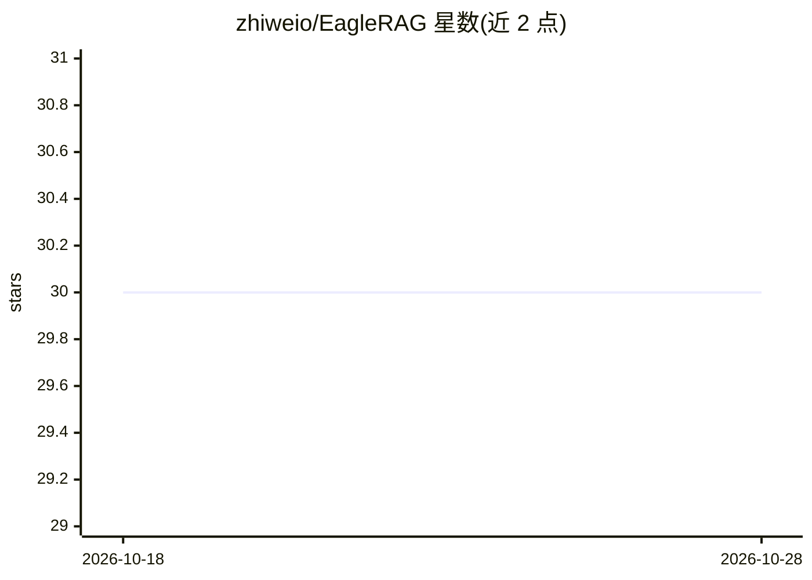

# zhiweio/EagleRAG

⭐ 30 · Python · Apache-2.0 · 推送 2026-07-25 · [GitHub](https://github.com/zhiweio/EagleRAG) · [官网](https://zhiweio.github.io/EagleRAG/) · 组织维护 · 中文 README

**给企业的多租户多模态 RAG 平台：语义+视觉双路检索并带引用生成**

Eagle-RAG 是面向企业场景的 RAG 平台：接入 PDF、Office、扫描件与网页，经 Knowhere 语义解析与 PixelRAG 视觉感知双通道入库，在 Milvus 上做多向量混合检索（RRR/RRF 融合、稠密+稀疏、图扩展），由 DeepSeek-V4-Pro 路由生成、Qwen-VL-Max 读图、qwen3-rerank 重排，回答带 [n] 行内引用与完整溯源坐标。采用微内核+仓库内插件架构，通过 EAGLE_RAG_PROFILE 绑定域（biomed 插件为实验性、lakehouse_bi 开发中），并以 MCP 工具服务器向下游 Agent 暴露 ingest/检索能力。基础设施含 Milvus/PostgreSQL/Redis/MinIO，Docker Compose 一键启动；模型仅支持 DeepSeek+Qwen，不使用 OpenAI/Cohere。

## 筛选速览

| 维度 | 判定 | 备注 |
|---|---|---|
| AI 角色 | `ai-ecosystem` | LLM/agent 周边工具 |
| 许可风险 | `permissive` | Apache-2.0 |
| 部署形态 | `self-host` | docker 或自建部署 |
| 模型依赖 | locked-api |  |
| 硬件要求 | — | 无带数字的原话,不猜 |
| 安装摩擦 | `low` | 无编译、无系统依赖或容器化 |
| 成熟度 | `idea` | |

## 能力要点

- Knowhere 语义分块 + PixelRAG 视觉瓦片的双通道摄取与多向量混合检索
- 回答携带 [n] 行内引用及 path/document_id/page_nums 等完整溯源坐标
- 两层隔离：plugin_namespace 绑定 Milvus Database，kb_name 标量过滤实现多租户
- MCP 工具服务器（streamable HTTP + stdio 回退）暴露 core_* 及域插件工具

## 适用场景

- 多团队各建独立知识库且数据互不混杂
- 对扫描件、图表等视觉内容与文本一起做带引用的多模态问答
- 作为后端数据层，通过 MCP 为下游 Agent 提供检索与问答工具

## 场景标签

`RAG` `多模态` · 领域:知识与检索

## 证据(README 行号)

> L32: Eagle-RAG uses a **microkernel + in-repo plugins** architecture: Core (`namespace=core`) provides ingest, multimoda
> L55: - **MCP tool server** — exposes `core_ingest` / `core_query` / `core_retrieve_text` / `core_retrieve_visual` over s
> L50: - **Dual ingestion pipelines** — Knowhere (external HTTP service `:5005`, invoked via the official `knowhere-python

## 星数曲线

2026-10-18 30 → 2026-10-28 30（+0）

---
*卡片 v1 · prompt 1.4 · 生成 2026-10-26 · 置信度 high · 依据 README sha `adecf04d2122` · [字段定义](../../DATASET.md)*
