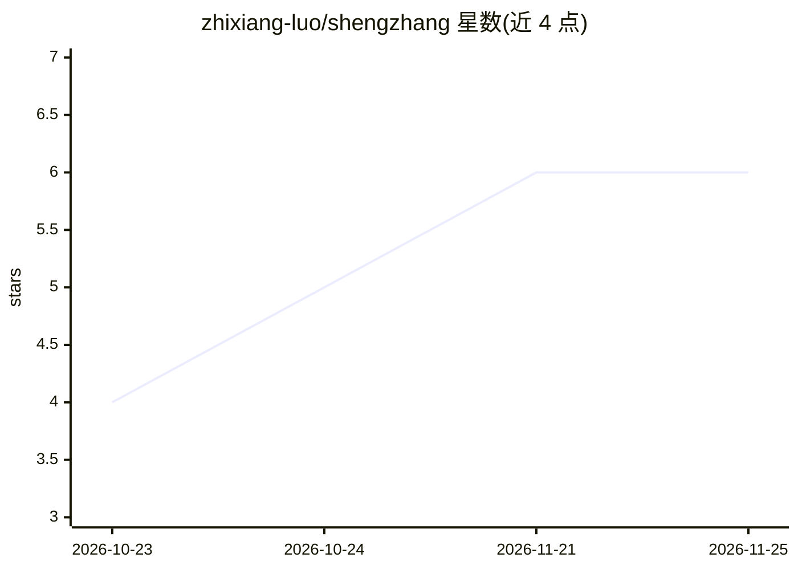

# zhixiang-luo/shengzhang

⭐ 6 · TypeScript · MIT · 推送 2026-11-23 · [GitHub](https://github.com/zhixiang-luo/shengzhang) · [官网](https://bigai.xin/shengzhang/) · 个人维护 · 中文 README

**面向年轻个人用户的语音一句话记账应用**

Expo/React Native 开发的语音优先、本地优先个人记账应用：按住说话，经火山流式 ASR 转写后由 DeepSeek 提取金额、分类、日期等字段，多笔账单写入本地 SQLite，支持 8 秒撤销与手动记账兜底。数据本地存储，网络失败不阻塞记账，提供备份/CSV 导出、月度统计、付款页快捷记账、匿名统计与反馈。需 Node.js 22+/pnpm 运行，云服务需自配 API key。MIT 开源，但名称、Logo 与视觉不随代码授权。

## 筛选速览

| 维度 | 判定 | 备注 |
|---|---|---|
| AI 角色 | `ai-enhanced` | 去掉 AI 部分产品仍成立 |
| 许可风险 | `permissive` | MIT |
| 部署形态 | `library` | 以包/库形式分发 |
| 模型依赖 | locked-api |  |
| 硬件要求 | — | 无带数字的原话,不猜 |
| 安装摩擦 | `low` | 无编译、无系统依赖或容器化 |
| 成熟度 | `idea` | |

## 能力要点

- 语音链路：PCM → Fastify WebSocket → 火山双向流式 ASR → DeepSeek 结构化
- 本地优先：账单首先写入 SQLite，登录与云备份非前置条件
- Android 11+ 微信/支付宝付款页磁贴快捷记账，一次确认写本地账本
- 410 项自动化测试与 200 条中文 TTS 语音基线

## 适用场景

- 午饭后说一句"午饭 25，咖啡 18"完成多笔记账
- 付款页长按磁贴快捷记录微信/支付宝消费
- 离线搜索、分类管理与月度统计回顾支出

## 场景标签

`语音识别` · 领域:感知与多模态

## 证据(README 行号)

> L10:  一款面向中国内地年轻个人用户的语音优先记账应用。
> L53: 2. 火山流式 ASR 实时返回文字。
> L92: - **本地优先**：账单首先写入 SQLite，网络、登录和云备份不是记账前置条件。

## 星数曲线

2026-10-23 4 → 2026-11-25 6（+2）

---
*卡片 v1 · prompt 1.4 · 生成 2026-11-20 · 置信度 mid · 依据 README sha `58b08dab0447` · [字段定义](../../DATASET.md)*
