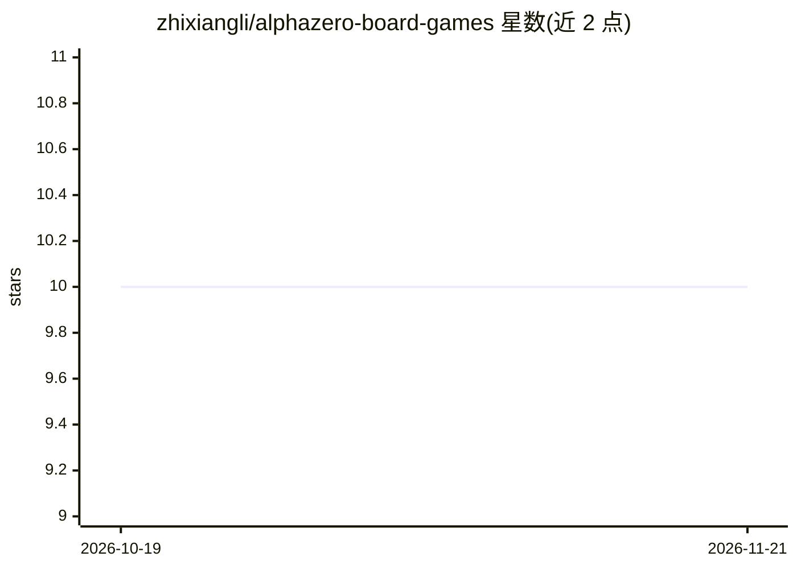

# zhixiangli/alphazero-board-games

⭐ 10 · Python · Apache-2.0 · 推送 2026-08-05 · [GitHub](https://github.com/zhixiangli/alphazero-board-games) · 个人维护

**终端可玩的 AlphaZero 五子棋/Connect4 训练与对弈实现**

以 AlphaZero 方法实现的棋类 AI 项目：共享核心（游戏 API、MCTS、残差策略/价值网络、自博弈强化学习循环）加上 Gomoku 9×9、Gomoku 15×15、Connect4 三个预设，每个预设含训练器与 stdio 终端对弈入口。随仓库附带预训练 checkpoint，安装后无需自行训练即可开局对弈；提供 CLI 参数控制执子颜色、MCTS 模拟次数与 checkpoint 路径。依赖 Python 3.12+ 与 uv，Apache-2.0 许可，配 GitHub Actions CI。

## 筛选速览

| 维度 | 判定 | 备注 |
|---|---|---|
| AI 角色 | `ai-native` | 本体是模型或模型工具 |
| 许可风险 | `permissive` | Apache-2.0 |
| 部署形态 | `None` |  |
| 模型依赖 | — | README 未给出锁定关系 |
| 硬件要求 | — | 无带数字的原话,不猜 |
| 安装摩擦 | `low` | 无编译、无系统依赖或容器化 |
| 成熟度 | — | 结构信号不足 |

## 能力要点

- 三个即用预设：Gomoku 9×9、Gomoku 15×15、Connect4
- 自带预训练 checkpoint，安装后可立即对弈
- MCTS + 残差策略/价值网络的 AlphaZero 自博弈训练循环
- stdio 终端对弈与可覆盖的训练参数

## 适用场景

- 在终端直接与预训练五子棋 AI 对弈
- 从头自博弈训练棋类模型
- 作为学习 AlphaZero 实现细节的代码参考

## 场景标签

`模型训练` `强化学习` · 领域:训练与推理

## 证据(README 行号)

> L3: Train and play strong board-game AIs from your terminal with a clean, practical AlphaZero implementation.
> L16: alphazero/      Shared core (game API, MCTS, network, RL loop)
> L11: - **Three ready presets**: Gomoku 9×9, Gomoku 15×15, Connect4

## 星数曲线

2026-10-19 10 → 2026-11-21 10（+0）

---
*卡片 v1 · prompt 1.4 · 生成 2026-11-19 · 置信度 high · 依据 README sha `b1a3a9fbd7ca` · [字段定义](../../DATASET.md)*
