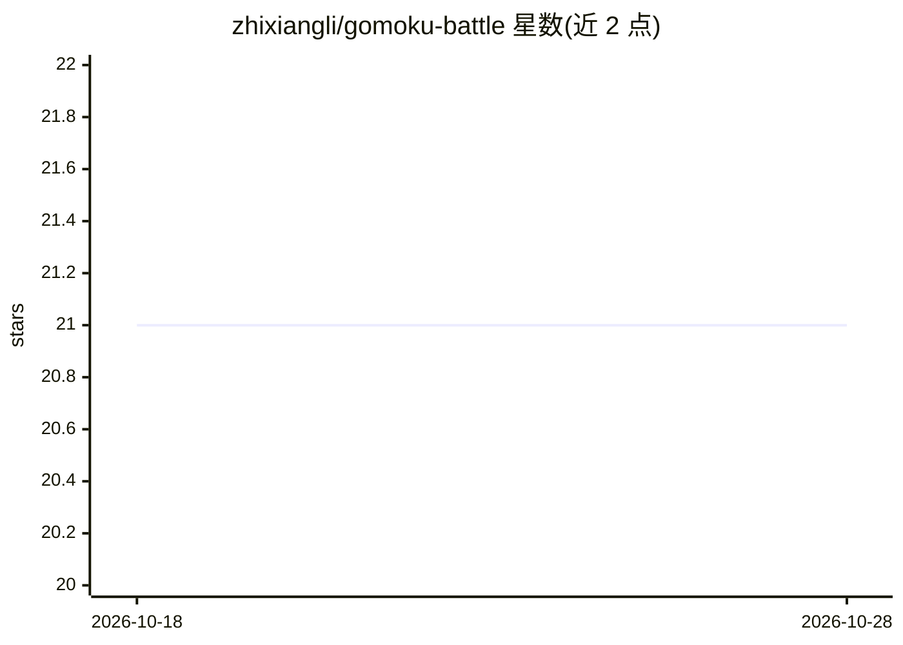

# zhixiangli/gomoku-battle

⭐ 21 · Java · 推送 2026-10-11 · [GitHub](https://github.com/zhixiangli/gomoku-battle) · 个人维护

**跨语言五子棋 AI 对战平台：运行并比较不同 agent**

可插拔的五子棋 AI 竞技平台：agent 以子进程方式启动，通过 stdin/stdout 交换 JSON 命令接入，裁判程序负责对局执行。核心模块包括棋盘模型与规则检查的 core、运行对局的 console、JavaFX 实时可视化 dashboard，并内置 Alpha-Beta Search（Java）与 AlphaZero（MCTS+神经网络，Python）两个 agent 作为基线。需要 Java 25、Maven 3.9+，AlphaZero 需 Python 3.12、uv 与已训练的 .pt 模型。

## 筛选速览

| 维度 | 判定 | 备注 |
|---|---|---|
| AI 角色 | `ai-ecosystem` | LLM/agent 周边工具 |
| 许可风险 | `none` | — |
| 部署形态 | `None` |  |
| 模型依赖 | — | README 未给出锁定关系 |
| 硬件要求 | — | 无带数字的原话,不猜 |
| 安装摩擦 | `low` | 无编译、无系统依赖或容器化 |
| 成熟度 | — | 结构信号不足 |

## 能力要点

- 跨语言 agent 接入：子进程 + stdio JSON 协议
- 内置 Alpha-Beta Search 与 AlphaZero 基线 agent
- JavaFX dashboard 实时对局可视化，可选 Human 参战
- -p 预检模式检查 AlphaZero 依赖与 checkpoint

## 适用场景

- 实现自己的五子棋 agent 与基线 AI 对战
- 可视化观察不同算法（Alpha-Beta vs AlphaZero）对局过程
- 作为课程或比赛中多个 AI agent 的统一竞技环境

## 场景标签

 · 领域:游戏 AI/agent 竞技

## 证据(README 行号)

> L13: **Gomoku Battle** is a pluggable platform for running Gomoku AI matches across languages. Implement an agent, conne
> L20: |**gomoku-battle-console**|Match referee that runs agents as subprocesses and exchanges JSON commands|
> L78: The console spawns each agent as a subprocess and communicates over JSON (`stdin` / `stdout`).

## 星数曲线

2026-10-18 21 → 2026-10-28 21（+0）

---
*卡片 v1 · prompt 1.4 · 生成 2026-10-28 · 置信度 high · 依据 README sha `3d2845bd2f79` · [字段定义](../../DATASET.md)*
