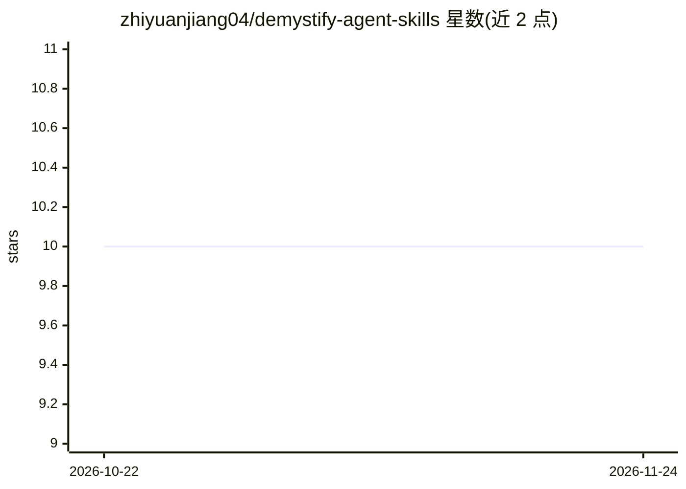

# zhiyuanjiang04/demystify-agent-skills

⭐ 10 · Python · 推送 2026-08-19 · [GitHub](https://github.com/zhiyuanjiang04/demystify-agent-skills) · [官网](https://zhiyuanjiang04.github.io/demystify-agent-skills/) · 组织维护

**研究 agent 技能何时有效、为何有效、何处失效的论文代码库**

论文《Demystifying Agent Skills》的 research code and artifacts：将 agent 技能视为程序性经验的结构化包，围绕表示方式、结果标注、跨框架迁移、检索与使用四个比较维度开展实验。仓库提供可复用的端到端实验流水线（pm2s-clean），覆盖轨迹采集、workflow 导出、技能生成、注入评测与三路检索诊断；运行依赖 Harbor runtime、基准数据集与各 provider 凭证，需按阶段配置环境变量后以 bash/python 脚本执行。

## 筛选速览

| 维度 | 判定 | 备注 |
|---|---|---|
| AI 角色 | `ai-knowledge` | 知识聚合/清单类 |
| 许可风险 | `none` | — |
| 部署形态 | `None` |  |
| 模型依赖 | — | README 未给出锁定关系 |
| 硬件要求 | — | 无带数字的原话,不猜 |
| 安装摩擦 | `low` | 无编译、无系统依赖或容器化 |
| 成熟度 | — | 结构信号不足 |

## 能力要点

- 四维比较研究设计：表示、结果标注、框架迁移、检索与使用
- 端到端复现流水线：轨迹采集→workflow 导出→技能生成→评测
- 三路独立检索诊断（嵌入排序/agent 选择/真实执行）
- 支持 Gemini CLI、OpenAI 兼容 API、Codex、Claude Code 多种运行时

## 适用场景

- 复现论文中技能机制与失败边界的实验
- 在自己的 benchmark 上对比 skill 与 workflow 基线
- 评估技能池规模对检索与实际使用精度的影响

## 场景标签

`模型评测` `科研工具` · 领域:评测与运维

## 证据(README 行号)

> L13: Research code and artifacts for the paper Demystifying Agent Skills: Why They Work - Until They Don't.
> L17: Aggregate success tells us that a skill helped, but not why, when, or whether the agent used the right one. We stud

## 星数曲线

2026-10-22 10 → 2026-11-24 10（+0）

---
*卡片 v1 · prompt 1.4 · 生成 2026-11-19 · 置信度 high · 依据 README sha `7e88471ab7c2` · [字段定义](../../DATASET.md)*
