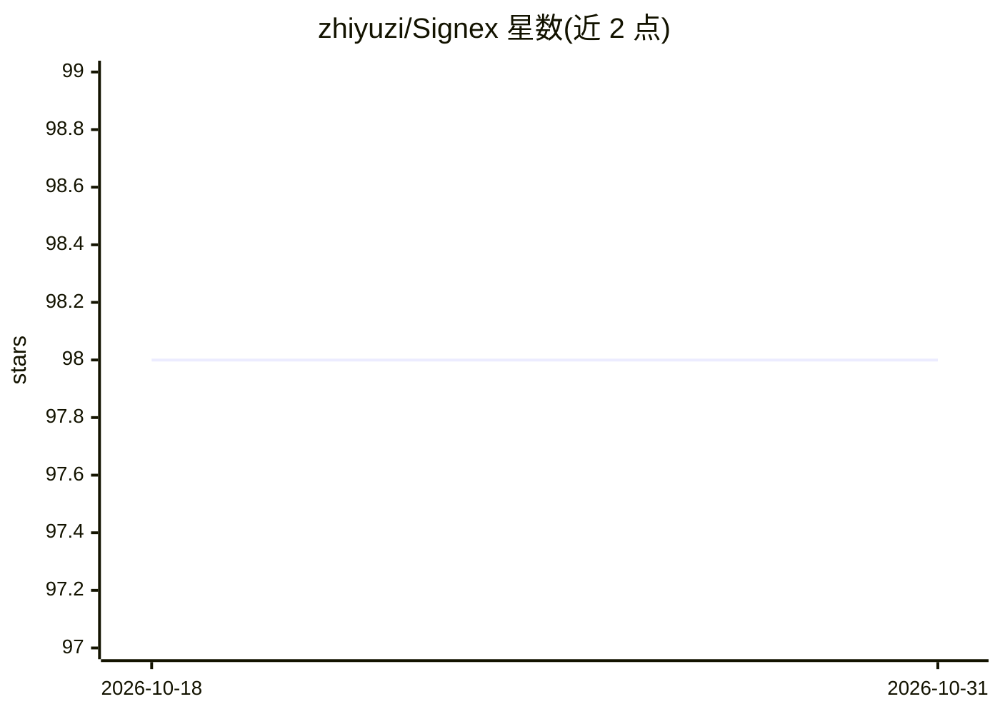

# zhiyuzi/Signex

⭐ 98 · Python · AGPL-3.0 · 推送 2026-02-27 · [GitHub](https://github.com/zhiyuzi/Signex) · [官网](https://signex.fyi) · 个人维护 · 中文 README

**运行于 Claude Code 的个人信息情报 agent：自动采集分析多源信号**

以 Claude Code 作为运行时的个人情报代理：用户用一句话定义 Watch（监控意图），agent 通过 16 个传感器技能从 Hacker News、GitHub Trending、Reddit、RSS、arXiv 等来源采集数据，存入 SQLite 去重，再以 4 种 Lens（深度洞察/快报/利弊/时间线）分析并生成报告。无独立应用或服务器，行为定义在 CLAUDE.md，能力为 .claude/skills/ 下的模块化技能；记忆用户反馈调整后续分析，支持飞书/Discord/企微 webhook 推送。需 Python 3.11+、uv 与 Claude Code CLI。

## 筛选速览

| 维度 | 判定 | 备注 |
|---|---|---|
| AI 角色 | `ai-native` | 本体是模型或模型工具 |
| 许可风险 | `viral` | AGPL-3.0 |
| 部署形态 | `None` |  |
| 模型依赖 | locked-api |  |
| 硬件要求 | — | 无带数字的原话,不猜 |
| 安装摩擦 | `low` | 无编译、无系统依赖或容器化 |
| 成熟度 | — | 结构信号不足 |

## 能力要点

- 16 个传感器技能覆盖 HN/GitHub/Reddit/arXiv 等 15+ 数据源
- 4 种分析视角（深度洞察、快报、利弊评估、时间线重建）
- SQLite 存储带自动去重与数据源健康监控
- 用户反馈写入 watch 记忆，迭代分析偏好

## 适用场景

- 一句话定义监控方向，自动跟踪竞品与技术趋势
- 持续跟踪某领域的论文与社区动态并收报告
- 把报告摘要推送到飞书/Discord 等即时通讯工具

## 场景标签

`AI 助手` · 领域:对话与助手

## 证据(README 行号)

> L7: A personal intelligence agent that runs entirely inside Claude Code.
> L17: Signex does this for you. Describe what you care about in one sentence, and it automatically collects from 15+ data
> L31: Signex is your AI intelligence analyst. You define what you care about (a "Watch"), and it autonomously collects da

## 星数曲线

2026-10-18 98 → 2026-10-31 98（+0）

---
*卡片 v1 · prompt 1.4 · 生成 2026-10-23 · 置信度 high · 依据 README sha `ea8c7811ac24` · [字段定义](../../DATASET.md)*
