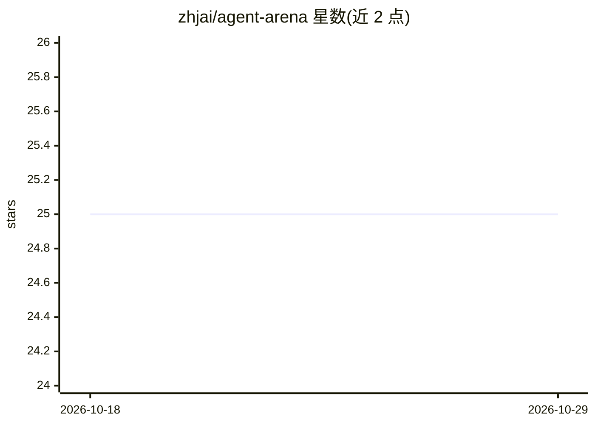

# zhjai/agent-arena

⭐ 25 · Python · MIT · 推送 2026-10-09 · [GitHub](https://github.com/zhjai/agent-arena) · [官网](https://github.com/zhjai/agent-arena) · 个人维护 · 中文 README

**多智能体辩论技能：让 Codex 与 Claude Code 交叉评审代码决策**

面向 AI 编程 agent（Claude Code、OpenAI Codex、Hermes Agent 等）的协议/指令型技能包，非可执行编排器：让两个异构 agent 独立生成方案，经声明抽取、证据核查、交叉批评、盲评后合成结论并保留异议。支持 GLM/DeepSeek/Qwen 等替代模型后端经代理接入。含 supervised_execution 分步监督执行与 companion_review 后台并行审查两个可选模式；提供主技能 agent-arena 与轻量伴生 deliberative-analysis。通过 npx skills CLI 或手动复制 SKILL.md 文件夹安装。限制：不安装、认证或自动调用任何 agent，跨 agent 执行依赖宿主 agent 与本地 CLI。

## 筛选速览

| 维度 | 判定 | 备注 |
|---|---|---|
| AI 角色 | `ai-ecosystem` | LLM/agent 周边工具 |
| 许可风险 | `permissive` | MIT |
| 部署形态 | `desktop` | 安装包/桌面程序 |
| 模型依赖 | — | README 未给出锁定关系 |
| 硬件要求 | — | 无带数字的原话,不猜 |
| 安装摩擦 | `low` | 无编译、无系统依赖或容器化 |
| 成熟度 | — | 结构信号不足 |

## 能力要点

- 独立生成→声明抽取→证据核查→交叉批评→盲评→合成的辩论协议，异议被保留
- 支持 GLM/DeepSeek/Qwen/Kimi/豆包等替代模型后端组成跨模型评审组
- supervised_execution 逐步 PASS/RETRY/BLOCKED 校验式执行模式
- npx skills add 一键安装到 Claude Code、Codex、Cursor 等 50+ agent

## 适用场景

- 架构决策前让两个模型独立评审并互相批评
- 合并前对 PR 或实现计划做红队审查
- 用竞争性假设定位 bug 根因
- 对 RAG 回答声明做证据核查

## 场景标签

`多智能体` `代码审查` · 领域:Agent 开发

## 证据(README 行号)

> L26: > **Important:** this repository is a protocol/instruction skill with an optional local result parser, not an execu
> L22: It is designed for **Claude Code, OpenAI Codex, Hermes Agent, OpenClaw, OpenCode, Copilot CLI, and other AI coding 

## 星数曲线

2026-10-18 25 → 2026-10-29 25（+0）

---
*卡片 v1 · prompt 1.4 · 生成 2026-10-26 · 置信度 high · 依据 README sha `fbc9b6dfb4a4` · [字段定义](../../DATASET.md)*
